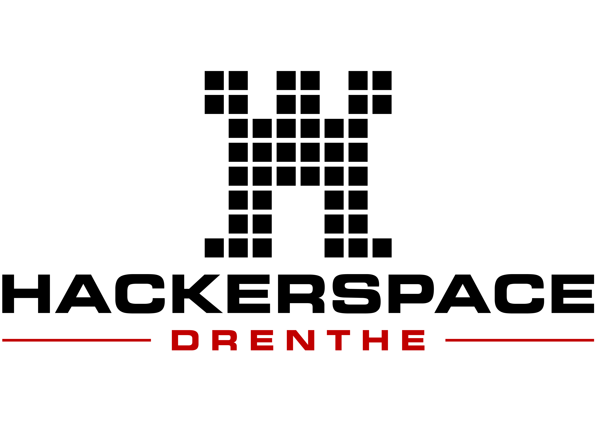
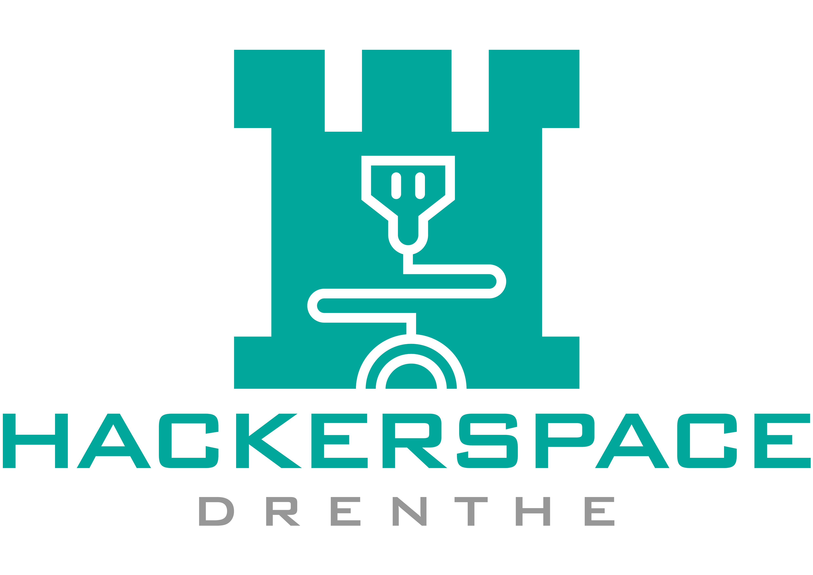
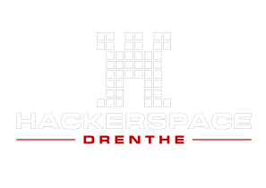

# Logo's

Hier staan alle logo-varianten van Hackerspace Drenthe op een centrale plek.

De logo's staan ook op https://github.com/Hackerspace-drenthe/logo

# 3d printbare logo's

Het logo bestaat ook in 3d variant, zie hier:

https://cloud.hackerspace-drenthe.nl/s/xw2mnX6i2YGm8D7?path=%2F
