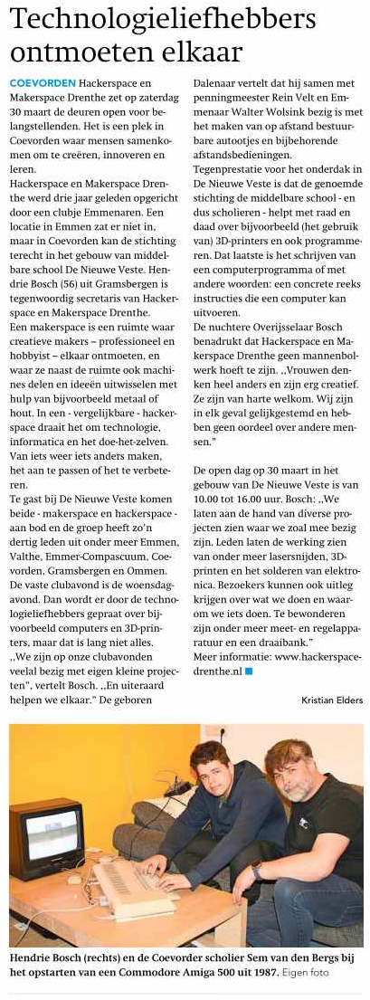

In de media verscheen aandacht voor Hackerspace Drenthe, van de opening in Coevorden tot recentere projecten. De publicaties hieronder staan van nieuw naar oud.

## 2026

- **Oktober – Krant, Coevorder Courant (via DVHN):** [Willy Wortels van Coevorden bouwen, programmeren en experimenteren. Het is leuk om oplossingen te bedenken](https://www.dvhn.nl/weekbladen-drenthe/coevorder-courant/willy-wortels-van-coevorden-bouwen-programmeren-en-experimenteren.-het-is-leuk-om-oplossingen-te-bedenken/164086582.html).
- **Mei – Online, ZO!34:** [Hackerspace Drenthe werkt aan een noodnetwerk voor de provincie](https://www.zo34.nl/nieuws/13466/hackerspace-drenthe-werkt-aan-een-noodnetwerk-voor-de-provincie/).
- **7 mei – Televisie, RTV Drenthe:** [Hackerspace Drenthe werkt aan Noodnetwerk](https://www.rtvdrenthe.nl/video/DNO260507GE/hackerspace-drenthe-werkt-aan-noodnetwerk). De reportage is te bekijken in de videospeler op de website van RTV Drenthe.

## 2024

- **26 maart – Krant, Coevorder Courant:** krantenknipsel over de open dag.

## 2022

- **2 april – Televisie, RTV Drenthe:** ['Nerds' openen eerste hackerspace van Drenthe](https://www.rtvdrenthe.nl/nieuws/14553767/nerds-openen-eerste-hackerspace-van-drenthe).

  De reportage is hieronder te bekijken. Als de videospeler niet werkt, bekijk de reportage op [de website van RTV Drenthe](https://www.rtvdrenthe.nl/nieuws/14553767/nerds-openen-eerste-hackerspace-van-drenthe).

  <video controls preload="metadata" width="100%" aria-label="RTV Drenthe-reportage over de opening van Hackerspace Drenthe">
    <source src="https://d3vbm02trh7zmp.cloudfront.net/on-demand/media/2022/04/02/-Nerds--openen-eerste-hackerspace-van-Dren-DNO220402XV.mp4/master.m3u8" type="application/vnd.apple.mpegurl">
  </video>

- **2 april – Online, NOS Regio Drenthe:** [‘Nerds’ openen eerste hackerspace van Drenthe](https://nos.nl/regio/drenthe/artikel/251575-nerds-openen-eerste-hackerspace-van-drenthe) (link niet meer beschikbaar).
- **31 maart – Lokaal nieuws, Coevorden Nieuws:** [Eerste hackerspace van Drenthe opent in Coevorden](https://coevordernieuws.nl/nieuws/eerste-hackerspace-van-drenthe-opent-in-coevorden/).
- **26 maart – Radio, ZO!34:** [Interview met Adri over Hackerspace Drenthe](https://www.zo34.nl/podcasts/6/media/audio/218), in de podcast *Opstaan Doe Je Zo! – De Podcast* (#168).
- **25 maart – Online, Tweakers:** [Eerste hackerspace in Drenthe opent op 2 april zijn deuren](https://tweakers.net/geek/194842/eerste-hackerspace-in-drenthe-opent-op-2-april-zijn-deuren.html).
- **25 maart – Online, Hackaday:** [A Robot Game to Open Your Hackerspace](https://hackaday.com/2022/03/25/a-robot-game-to-open-your-hackerspace/).

- Ook verschenen doorplaatsingen op [Nerdswire](https://nerdswire.de/nl/ein-roboterspiel-um-ihren-hackerspace-zu-oeffnen/) en [Taylor Daily Press](https://www.taylordailypress.net/the-first-pirate-space-in-drenthe-to-open-its-doors-on-april-2-it-pro-geeks/).
