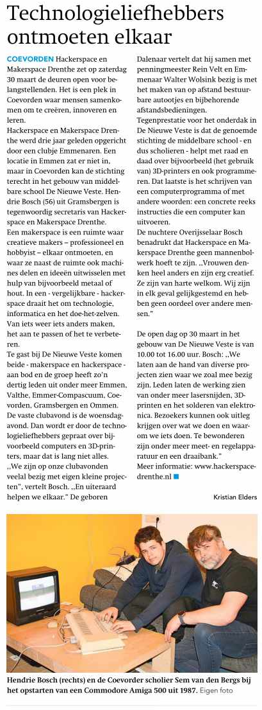

# Opening (2 april 2022)
* 25-3-2022, Artikel op Tweakers.net: https://tweakers.net/geek/194842/eerste-hackerspace-in-drenthe-opent-op-2-april-zijn-deuren.html
*25-3-2022, Artikel op Hackaday.com: https://hackaday.com/2022/03/25/a-robot-game-to-open-your-hackerspace/
*26-3-2022, Interview met Adri over hackerspace Drenthe  op radiozender ZO34: https://www.zo34.nl/podcasts/6/media/audio/218
* 26-3-2022, Artikel in Coevorder Nieuws: https://coevordernieuws.nl/nieuws/eerste-hackerspace-van-drenthe-opent-in-coevorden/
*2-4-2022, TV Drenthe: https://www.rtvdrenthe.nl/nieuws/14553767/nerds-openen-eerste-hackerspace-van-drenthe
*2-4-2022, NOS: [https://nos.nl/regio/drenthe/artikel/251575-nerds-openen-eerste-hackerspace-van-drenthe](https://nos.nl/regio/drenthe/artikel/251575-nerds-openen-eerste-hackerspace-van-drenthe?fbclid=IwAR1pZWO-hCy6tVaKlFPG9-vqnrFB0cvCLT9plh9ZOFA7kFTtgwGd6PQ12MI)
*https://nerdswire.de/nl/ein-roboterspiel-um-ihren-hackerspace-zu-oeffnen/
*https://www.taylordailypress.net/the-first-pirate-space-in-drenthe-to-open-its-doors-on-april-2-it-pro-geeks/

# Open dag (30 maart 2024)

