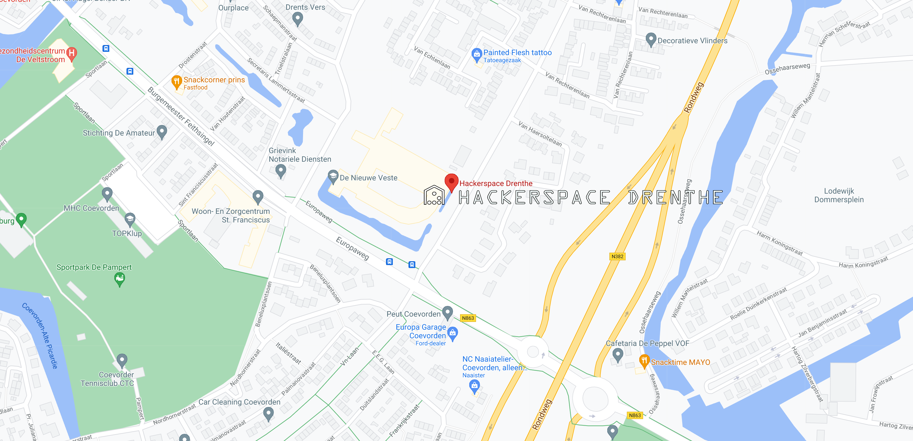
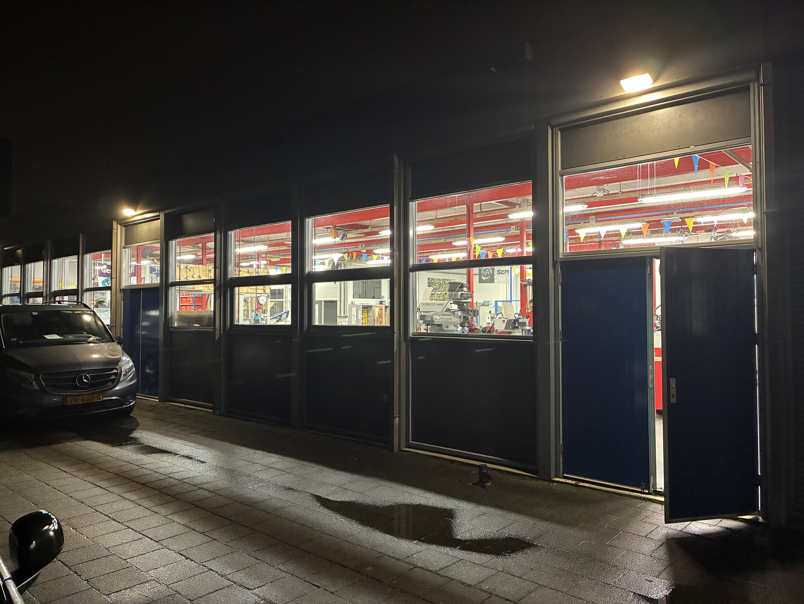
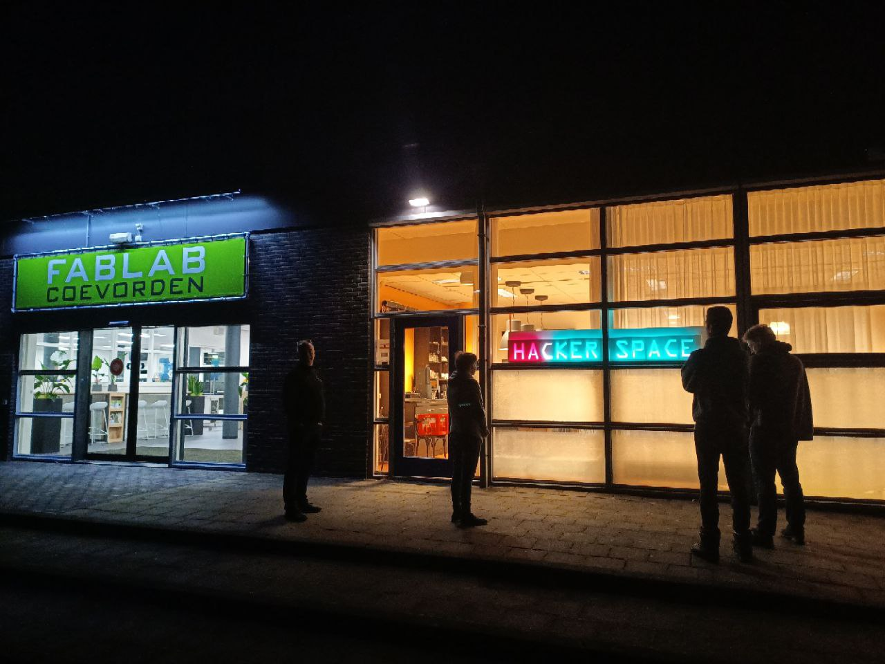
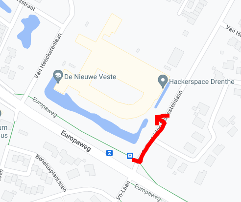

# Bezoek adres
 Graaf van Heiden Reinesteinlaan
 Ingang achterkant school, via  het plein.
 
 Je mag de auto op het plein parkeren. (ook al staat er verboden voor autos)

# Post adres
 HACKERSPACE DRENTHE
 Van Heeckerenlaan 2
 7742 AB Coevorden
 Netherlands
GPS Coordinaten: 52.6598995, 6.7550101
**Let op:** De ingang is aan de Graaf van Heiden Reinesteinlaan via de **Fablab**, aan de **ACHTERKANT** van de school.

* [Google routebeschrijving](https://www.google.com/maps/dir//Hackerspace+Drenthe,+Graaf+van+Heiden+Reinesteinlaan+7742,+7742+XK+Coevorden/@52.6586478,6.755661,17z/data=!4m9!4m8!1m0!1m5!1m1!1s0x47b7fd1284d9476f:0xaea7abeea126f118!2m2!1d6.7550411!2d52.6599173!3e0)
* [Openstreetmap routebeschrijving](https://www.openstreetmap.org/directions?engine=fossgis_osrm_car&route=%3B52.65982%2C6.75525#map=17/52.65971/6.75480)

# Openbaar vervoer
Via het OV kun je het beste naar Bushalte de nieuwe veste in Coevorden. Klik hier voor de correct ingevulde reisplanner:

Vanaf de bushalte is het 100 meter naar de ingang. (aan de achterkant van de school, naar het Fablab)

Het is ook mogelijk vanaf Centraal Station Coevorden te lopen, dan ben je ongeveer 20 minuten onderweg.

# Parkeren
## Op standaard dagen
Gratis parkeren kan vlak voor de space aan de straat.

## Bij drukte en open dagen
Als het druk is, is het ook mogelijk aan de voorkant bij de school te parkeren

Let er op dat deze hekken na schooltijd op slot gaan. We hebben hier wel sleutels van maar het is handig om op tijd te weten. :)
