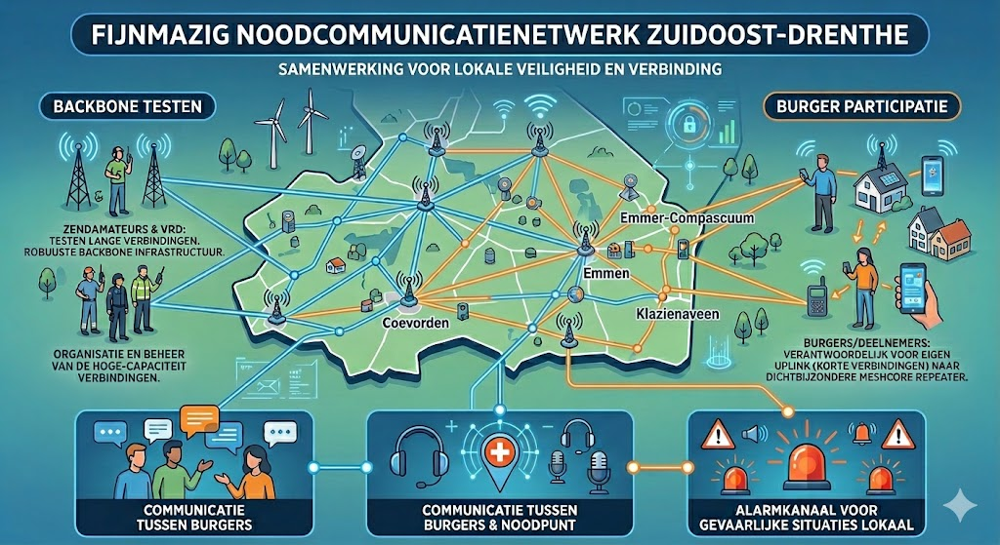
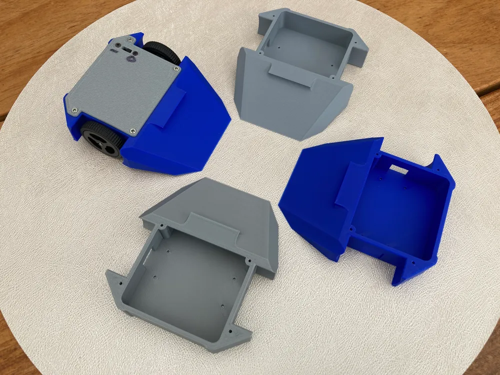

## Kernprojecten

| Drenthe Noodnetwerk | Roboktober |
| --- | --- |
|  |  |
| Een regionaal mesh-netwerk voor noodcommunicatie, met netwerkkaarten, praktische documentatie en leermateriaal. | Een communityproject rond combat robots, workshops en bouwen met deelnemers. |
| [Projectpagina](/projecten/drenthe-noodnetwerk) · [Website](https://drenthenoodnetwerk.nl) · [Broncode, ontwerp en documentatie](https://github.com/Hackerspace-drenthe/www.drenthenoodnetwerk.nl) | [Projectpagina](/projecten/roboktober) · [Website](https://www.roboktober.nl) · [Broncode, ontwerp en documentatie](https://github.com/Hackerspace-drenthe/www.roboktober.nl) |

De GitHub-repositories bevatten de volledige projecten, waaronder ontwerp, documentatie en code.

Oudere projecten:
* [Magician](/projecten/dobot/magician)
* [Ledder led matrixen](/projecten/ledder-led-matrixen)
* [Dobot AI starter robots](/projecten/dobot/dobot-ai-starter-robots)
* [Portaal CNC frees](/projecten/portaal-cnc-frees)
* [InnoFuture Blinkenlicht Plattegrond](/projecten/innofuture-blinkenlicht-plattegrond)

<!-- AUTO-INDEX:START -->
## Subpages

- [Documentatie](/projecten/documentatie)
<!-- AUTO-INDEX:END -->
