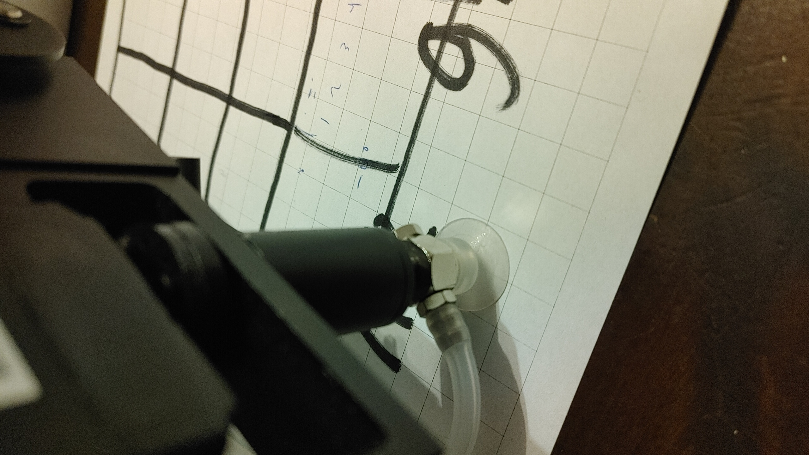
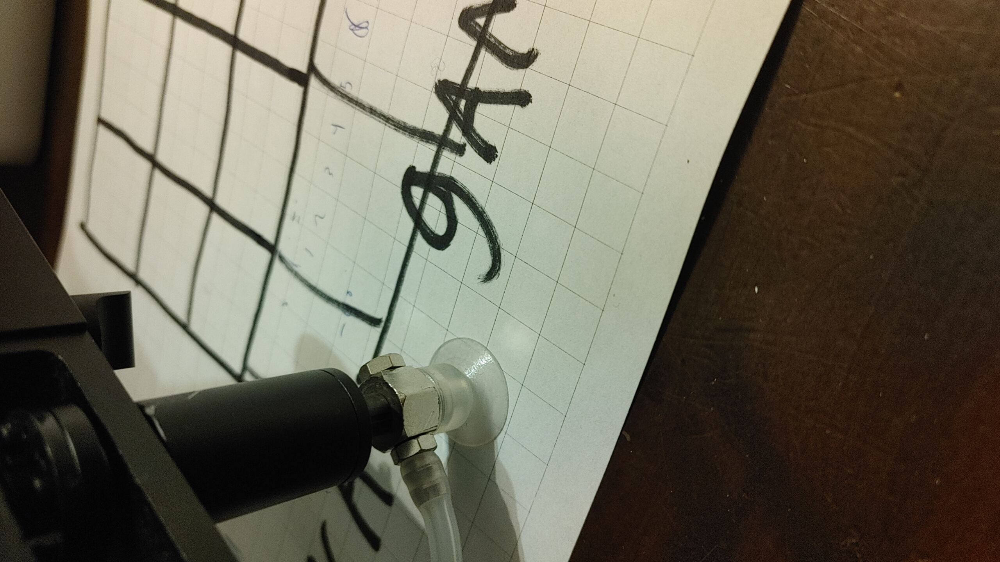
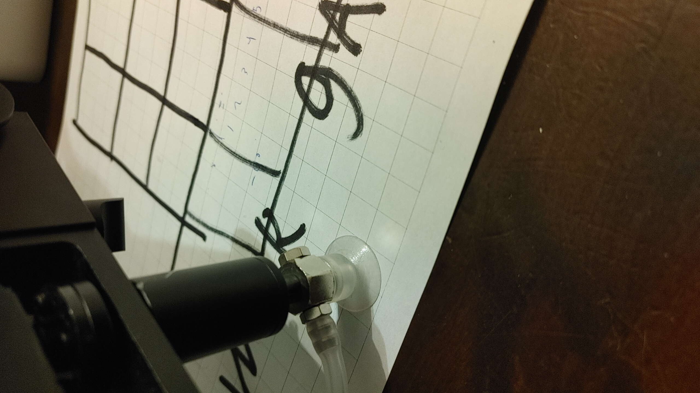
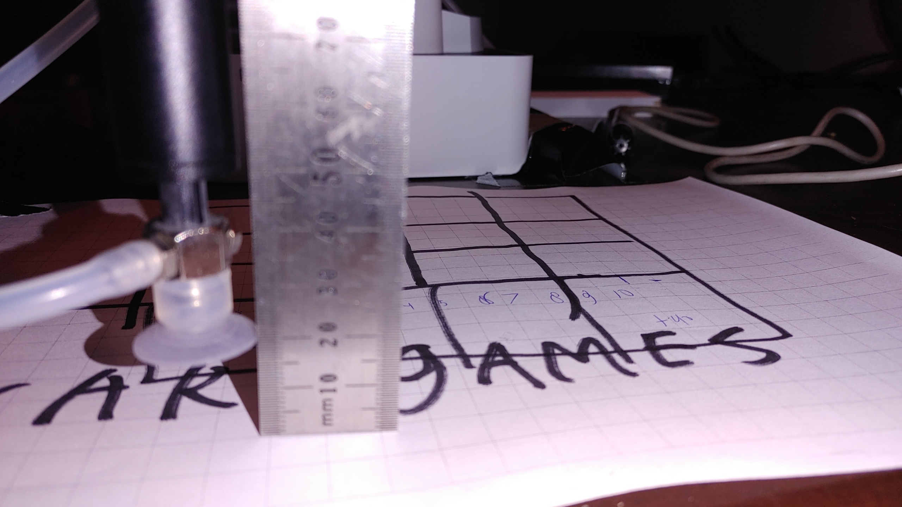
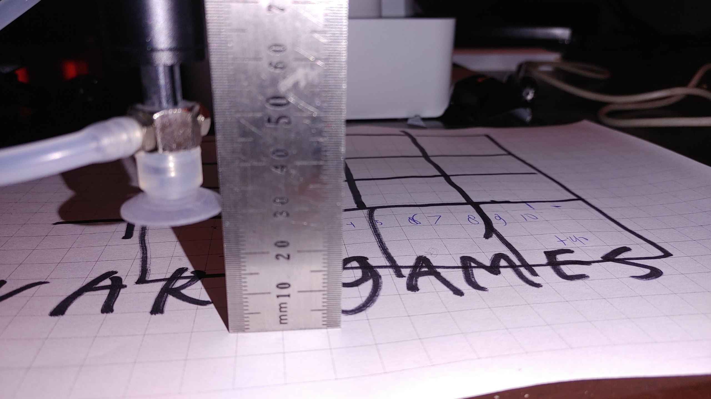

# Dobot calibratie check
( Volg eerst de [installatie instructies](/projecten/dobot) )

Het is erg belangrijk om te controleren of de calibratie klopt, anders kan de robot geen dingen bouwen.

Ga als volgt te werk:

* Pak een ruitjes papier 1x1cm (of een lineaal of iets anders waarvan je de maat weet)
* Leg deze zo recht mogelijk voor de robot mogelijk voor de robot. 
* Gebruik bestuur.py om de robot tegen de lijntjes te leggen, zorg dat het zuignap je het papier net raakt:

* Zet de stap groote op 10mm door op **5** te drukken
* Beweeg de robot 1 cm in de X richting (links rechts) en controleer het resultaat:

Zoals je ziet is bij deze robot het resultaat in de Y richting niet goed genoeg. (Toen ik nog meer stappen van 10mm deed werd de afwijking van de ruitjes lijnen steeds groter) Calibratie is dus nodig in dit geval!

De X as van deze robot is wel goed. (Probeer weer meerdere stappen om te kijken of de afwijking te groot word)

De Z as kun je eventueel ook nog controleren:

Ook deze lijkt redelijk goed.

Meestal is de Y as het probleem is mijn ervaring.

# Calibreren met Dobot studio
Het is mij niet gelukt om de robot in dit voorbeeld gekalibreerd te krijgen, dus als hij goed staat, vooral van af blijven. :) Ik heb zowel handmatige als auto leveling geprobeerd en de base calibration uitgevoerd, maar de Y-afwijking bleef onwerkbaar groot. (ongeveer Y-stappen van 13mm terwijl het 10mm moet zijn)

Hier wat tips:

* De handleiding en Dobot Studio vind je [hier](https://www.dobot.cc/downloadcenter/dobot-magician.html#most-download) (account nodig).
***Maak fotos van de calibratie getallen die voorbij komen en bij het Sensor and base tabje. Zo kun je de oude calibratie waarden herstellen als je het niet goed krijgt.**
* De nodige pen en autolevel tool voor de Dobot magician zijn aanwezig.
* De "manual calibration" kaart ligt onder in een bak met  "straat doeken", maar deze kaart stelt niet veel voor:
** Het eerste punt (A3) zit loodrecht voor het midden van de robot op 13.5cm afstand vanaf de voet.
** Het tweede punt (B3) zit nog 8 cm verder van de voet. (Volgensmij is alleen de 8cm afstand belangrijk en het feit dat ze loodrecht in het midden zitten op Y=0)
* Bij autoleveling kraakte de robot een paar keer et omdat hij over zn limieten wou, dus heb ik de home-positie op een lagere Z waarde ingesteld. Daarna deed hij dat niet meer.
* Ik heb op de dobot.cc forums gekeken, maar alle vragen over calibratie blijven onbeantwoord. Er stond ergens iemand die dacht dat de in de nieuwste firmware een probleem met auto calibratie ontstaan is en dat het met oude firmware wel goed ging.
