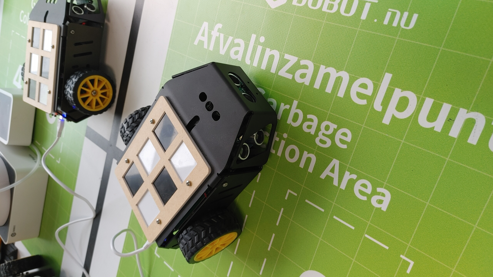
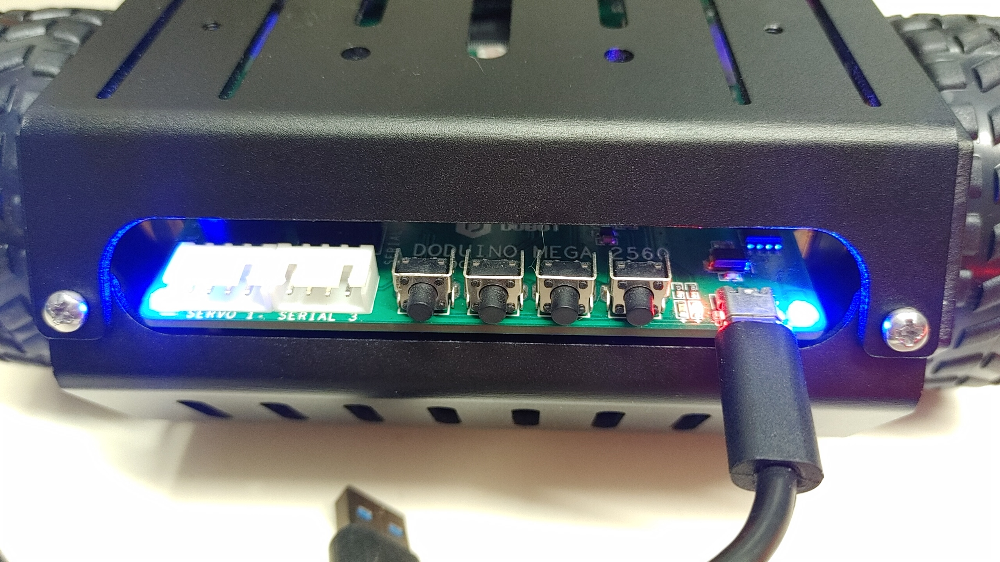
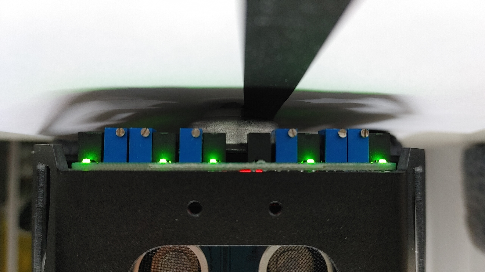
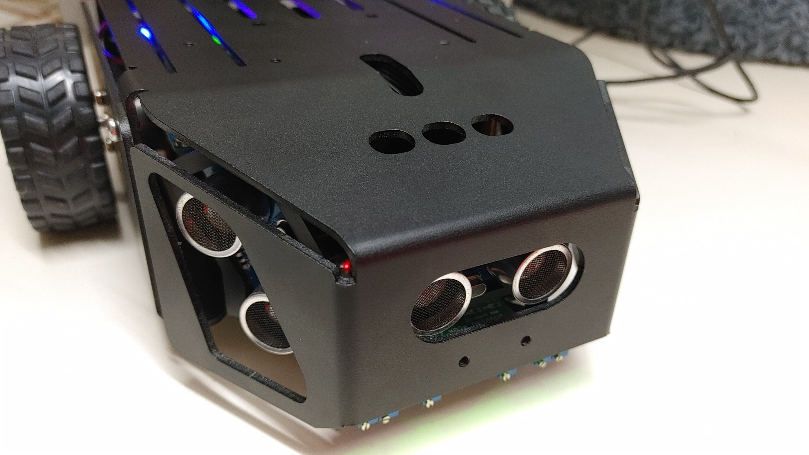
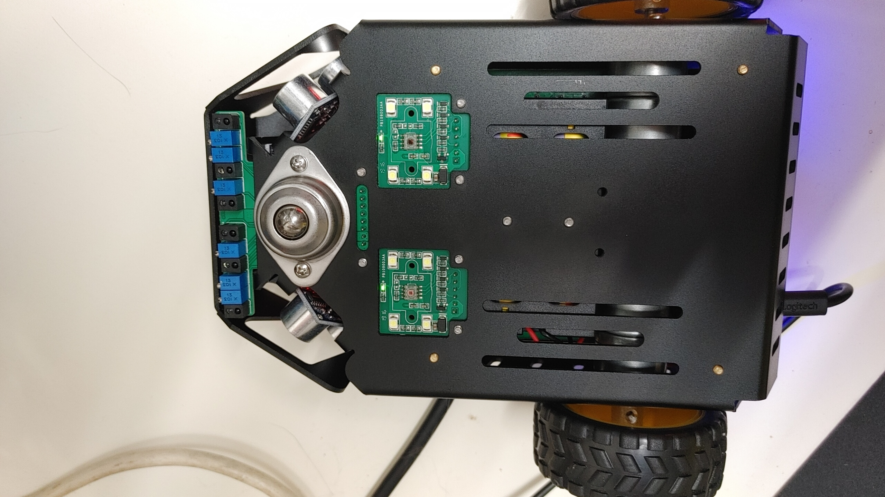
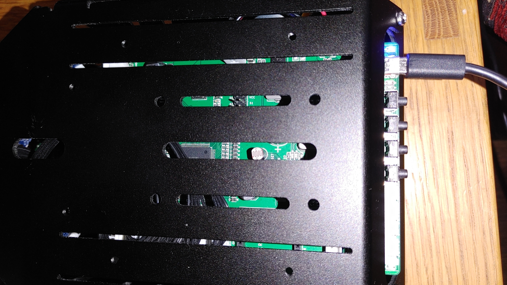
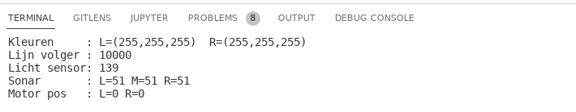

# Intro
De AI robots kunnen rondrijden en bevatten een aantal sensoren.

Met behulp van de sensoren kunnen ze lijnen volgen, obstakels detecteren en kleuren herkennen.

Intern heeft de robot een **DuDuino Mega2560 (Compatiable with Arduino Mega2560)**
# Achterkant

## Knoppen
Vier knoppen aan de achterkant, van links naar rechts:
* Knop A, B: Deze knoppen zijn uit te lezen door het programma en kunnen van alles doen.
* Knop C:  Word gebruikt om het programma te starten of pauzeren.
* PWR: Aan/uit
Uitlezen van knop A en B kan gewoon met een digitalRead:
 digitalRead(PINSW1)
(Knop A = PINSW1 en knop B = PINSW2)

Als de knop word ingedrukt geeft hij een 0 en in rust toestand een 1.

## Leds
* Linker en rechter blauwe led: Bepaald door het programma, kunnen van alles doen.
* 2 rode leds naast elkaar bij de USB poort:
** links: Brand als batterij bijna leeg is. (deze word aangestuurd via SmartBot.cpp)
** rechts: Brand als hij aan het laden is.
(De vier kleine leds binnen in geven waarschijnlijk ook de laadstatus aan.)

De blauwe leds aansturen kan als volgt:
 AIStarter_SmartBotSetLED(LED1, OFF);
 AIStarter_SmartBotSetLED(LED2, ON);
De waarde kan ON, OFF en BLINK zijn.

## USB
Opladen en programmeren gaat via de USB aansluiting.

# Voorkant, onder

Voor aan de onderkant vind je de lijn-volg sensoren.

**Controleer of de sensor goed werkt:** 

* Boven wit papier is het lampje aan.
* Boven een zwarte lijn is het lampje uit.

Als ze niet goed reageren kun je ze afstellen met een kleine schroevendraaier op de blauwe potmeters.

Uitlezen kan met:
 AIStarter_SmartBotGetIRModuleValue(IR1)
Voor IR1 t/m IR6.

Een IRsensor geeft 1 bij de kleur zwart en 0 bij wit.
# Voorkant

Aan de voorkant bevinden zich ultrasone sensoren. Totaal 3 stuks: Links, Midden en Rechts.

De ultrasone sensoren zenden een hoge geluids puls uit en kijken hoe lang het duurt voordat deze puls terug is. 

Het ene ronde ding is de luidspreker, de andere de microfoon.

De maximale meet afstand is meer dan 20cm.

Uitlezen kan met:
 AIStarter_SmartBotGetSonar(SONAR1)  
(Links, midden, rechts is SONAR1, SONAR2, SONAR3.

De uitgelezen waarde geeft de afstand in cm aan.

# Onderkant

Aan de onderkant bevinden zich 2 kleuren sensoren.

Deze sensoren kunnen een kleur herkennen als de robot er over heen rijdt.

Uitlezen gaat als volgt:
 
   char buffer[100];
 
   //start meting, witte leds gaan aan:
   AIStarter_ColorFlash();
   
   //wacht tot meting klaar is
   while (!AIStarter_ColorIsReady())
     delay(250);
 
   sprintf(buffer,
           "Kleuren     : L=(%3d,%3d,%3d)  R=(%3d,%3d,%3d) ",
           AIStarter_SmartBotGetColorSenor(COLORSENOR1, RCOLOR),
           AIStarter_SmartBotGetColorSenor(COLORSENOR1, GCOLOR),
           AIStarter_SmartBotGetColorSenor(COLORSENOR1, BCOLOR),
           AIStarter_SmartBotGetColorSenor(COLORSENOR2, RCOLOR),
           AIStarter_SmartBotGetColorSenor(COLORSENOR2, GCOLOR),
           AIStarter_SmartBotGetColorSenor(COLORSENOR2, BCOLOR));
 
   Serial.println(buffer);

# Bovenkant

Aan de bovenkant bevind zich binnenin nog een ronde licht sensor. De kan bijvoorbeeld gebruikt worden om te detecteren of er iets op de robot ligt.

Uitlezen kan met:
 AIStarter_SmartBotGetLightAnalog()
Hoe meer licht hoe lager de waarde. Bereik loopt van 0 tot 1024.

# Binnen in
## Motor encoders
De motoren hebben interne encoders om de stand van de wielen uit te lezen. Deze worden intern gebruikt om de motoren op de juiste gelijke snelheden te houden.

## Motoren aansturen
Het aansturen kan op 2 manieren.

* Via power aansturing (PWM) Op deze manier zijn de motoren "dom" en geef je ze gewoon een vaste power via een PWM waarde. Gebruik hiervoor **AIStarter_SmartBotSetMovment().** 
* Via snelheids regeling (PID). Deze manier heeft de voorkeur: Hierbij geef je een gewenste snelheid op, en de robot regelt zelf dat hij op die snelheid komt. Als de wielen bijvoorbeeld zwaarder zijn zal hij dit compenseren. Gebruik hiervoor **AIStarter_SmartBotSetMotor()**

Als je de veel power naar de motoren stuurt zal het systeem uitvallen en resetten.
## Compas
De robot heeft intern een compas, deze kan worden uitgelezen met:
 AIStarter_SmartBotGetCompass()

# Originele software
Het beste is om hier met een wijde boog om heen te lopen ;)

Originele software en handleiding is erg lastig te vinden op de originele site, en je bent een account nodig.

Dus hebben we ze [hier neergezet](https://github.com/Hackerspace-drenthe/dobot-ai-starter/tree/master/originals).

Onze software (hieronder) is handiger te gebruiken.

# Onze software
Onze software maakt bevat de libraries hierboven, met wat aanpassingen zodat het in platformIO werkt.

Deze vind je [hier](https://github.com/Hackerspace-drenthe/dobot-ai-starter).

## Sensor test
Om te testen of alles goed werkt, is het handig om eerst de sensors test te doen. Dit kan door in platform de "environment" sensortest te upload naar de bot.

Met de serial IO monitor zijn dan de sensor waarden te zien:

## Lijn volger
De lijnvolger bouw je door de "rider" environment te selecteren en uploaden.

Hij kan allemaal coole dingen, zie source code :)
