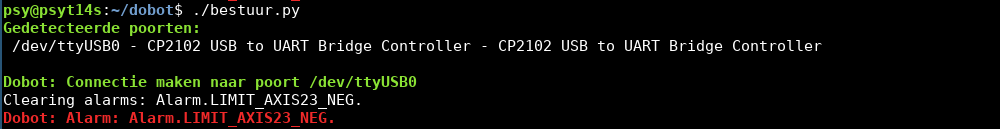
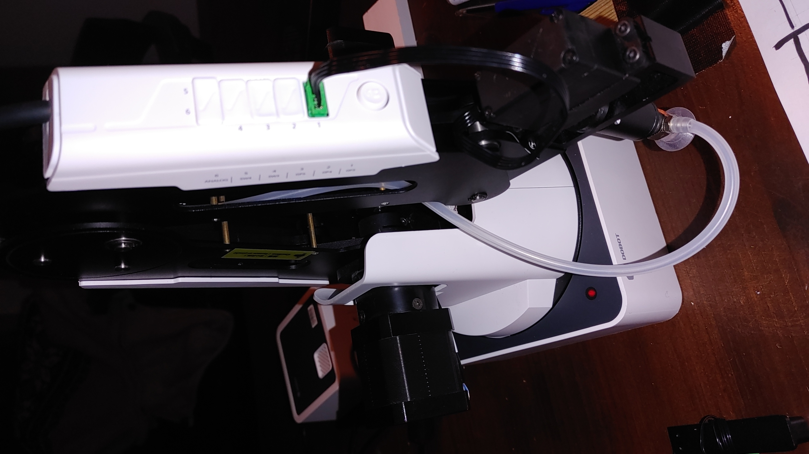
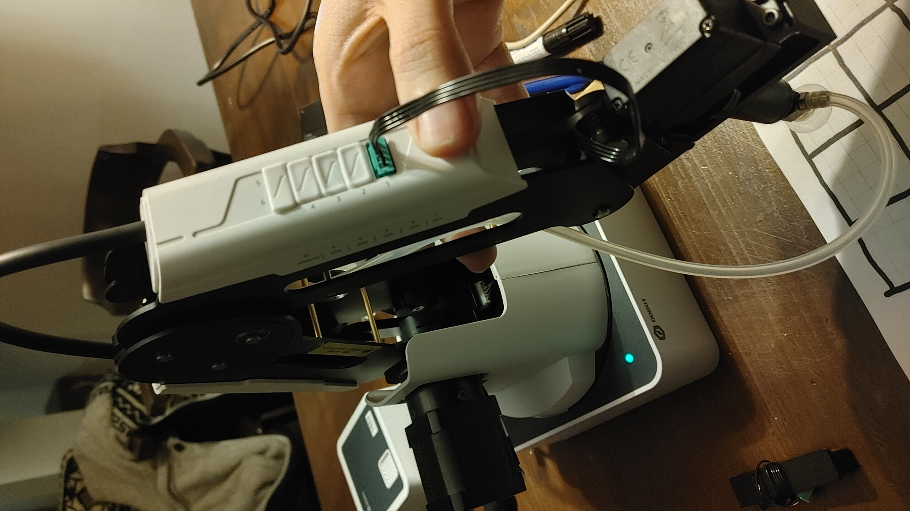
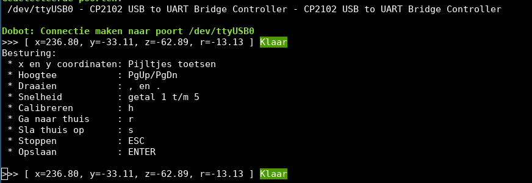

= Dobot Magician robots =

Hier vind je hoe je de dobot robots kunt gebruiken in python.

# Installatie
Voor alle leuke dingen ben je python en onze Dobot repository nodig. We gebruiken Dobot studio niet omdat die verschrikkelijk is. :) (Alleen nodig voor het calibreren)

Als het goed is werkt onze python code in Linux en Windows (nog niet getest)

Stappen:
*Installeer python en git

* Clone onze Dobot repository:
 git clone https://github.com/Hackerspace-drenthe/dobot.git
* Ga in de directory dobot met
 cd ./dobot
* installeer de python requirements uit requirements.txt:

 pip install -r requirements.txt

* Zorg dat de gebruiker lid is van de groep **dialout**

 $ sudo adduser (gebruikersnaam) dialout
Log hierna opnieuw in en controleer met het **id** of je lid bent.

# Eerste test en fouten oplossen
Kijk of je de robot kunt besturen met behulp van **bestuur.py:**

Hier gaat het mis en geeft de robot een alarm. (LIMIT_AXIS23_NEG) Meestal komt dit doordat de robot buiten zn maximale bereik staat, dit kun je ook zien aan het rode ledje:

"Pak" de robot vast door het knopje in te drukken en verplaats hem naar een legaal bereik. Als je het knopje los laat moet het ledje groen worden:
Poog nu nog een keer om het **bestuur.py** script te gebruiken:

Soms is het nodig het programma 1 of 2 keer te herstarten om uit de storing te komen, vooral als de status "Bezig..." blijft.

Met de pijltjes kun je de robot betsuren. Het is de 1e keer verstandig om de robot te "Homen" door op h te drukken.

De robot zoekt dan zn thuis postie op en weet daardoor zn coordinaten stelsel weer. 

Later is het meestal voldoende om de robot een kort stukje met de handen te verplaatsen zoals hierboven beschreven. Zodra je het knopje los laat leest hij namelijk zn coördinaten uit via de interne encoders.

# Volgende stappen
Nu je de robot aan de praat hebt kun je verder.

* Doe de eerste keer een [Calibratie check.](/projecten/dobot/calibrate) Sommige robots zijn verkeerd gecalibreert waardoor er niks van het cooridnaten stelsel klopt en alles mis gaat.
*Speel kruisje-rondje tegen de robot: [Wargames](/projecten/dobot/wargames)
