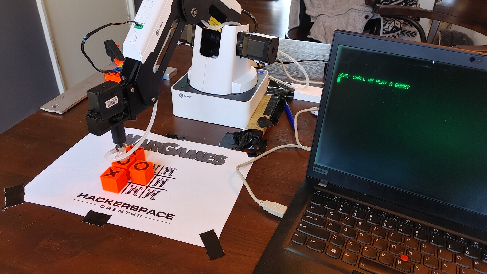

# WarGames with Dobot
Sometimes when bad stuff happens, old things get relevant again. Like the movie [WarGames.](https://www.imdb.com/title/tt0086567/)

Since we wanted to demonstrate our robots for the opening of our hackerspace, we decided to implement the oldest game in the world: You play tic-tac-toe against the computer by moving actual physical blocks.

The computer can of course also play against itself. It will make a random move for the player after a timeout of 30 seconds. This is to attract some attention, but to not be overly active. (it will wait 30 seconds after every move, and the player can continue any time.)

**Demo movie**: [Watch on YouTube](https://www.youtube.com/watch?v=CU9ZNw6YU00)  

Yes OFFCOURSE its with cool-retro-term :)

If you like this and want to see more, read about the [Hackerspace Drenthe opening in 2022](/nieuws/2-april-officiele-opening).

# The software
The software can be found at our github here: [github.com/Hackerspace-drenthe/dobot](https://github.com/Hackerspace-drenthe/dobot)

Its based on a python dobot library, but we added some fancy stuff and some easy to use higher level function. Its for example easy to grab the next available block from the storage and place it somewhere. The software will remember where you placed it, and there is a cleanup function to cleanup all the blocks again.

Difficult stuff like calibrating where the storage area is exactly is also made easy by an interactive calibration program. Since the real world introduces all kinds of inaccuracies, we've taken special care when placing the blocks back in storage: It carefully push the blocks back so that any introduced offset will be taken out again. 

It was created in such a way that it should be able to run indefinitely, without requiring manual intervention. (I was able to run it for a few hours without interfering) 

Most of the project instructions are in Dutch, so students from the school can understand and use the higher-level functions. The project and software are still a work in progress; see the [Dobot project page](/projecten/dobot).

Psy0rz
