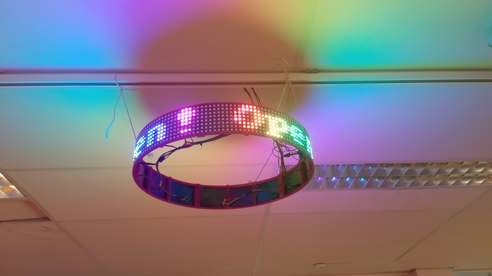
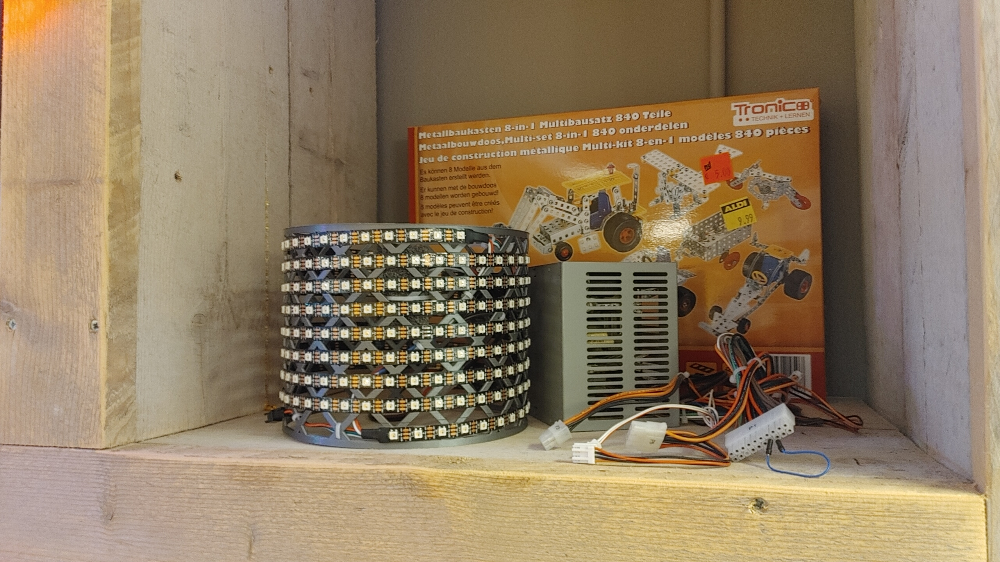
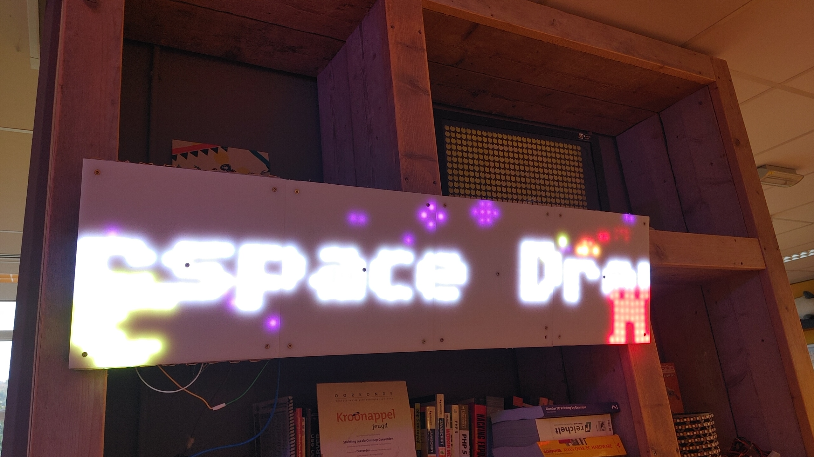
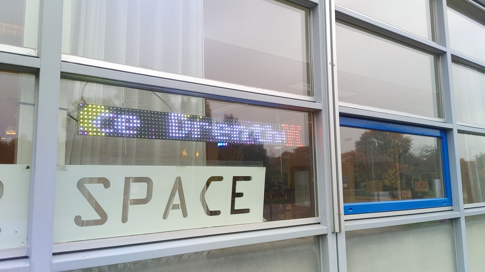

Dit project draait op diverse plekken in de space, maar er is nog geen documentatie :)

Animaties worden in nodejs gemaakt en gestreamed via het ledstream protocol naar de ledmatrixen.

Animatie framework (draait op server/laptop): [github.com/psy0rz/ledder](https://github.com/psy0rz/ledder)

Ledstream voor op ESP32: [github.com/psy0rz/ledstream](https://github.com/psy0rz/ledstream)

Als je er wat mee wilt help ik je wel. (Edwin)

# Cirkel lichtkrant boven de lounge
Deze draait nog op een oude versie van ledder, de raspberry pi stuurt hem rechstreeks aan. (moet hem nog updaten en driver porten van oude ledder)

Draait hier: [http://10.0.0.123:3000/](http://10.0.0.123:3000/)

(Gemaakt door Edwin)

# Ronde ledmatrix met RGBW
Doordat deze rgbw leds heeft werkt het niet met de standaard Fastled libary. 

Volgens mij zijn er wel hacks/forks voor om het te fixen. Nog uitzoeken dus.

# Grote lichtkrant

De grote lichtkrant van Pascal die binnen hangt. Word ook aangestuurd door [http://10.0.0.2:3000/#!/HSD/default](http://10.0.0.2:3000/#!/HSD/default)

(Gemaakt door Edwin)

# Lichtkrant voor het raam
Deze 75x8 word aangestuurd vanaf de ledder server, hier: [http://10.0.0.2:3001/#!/HSD/default](http://10.0.0.2:3001/#!/HSD/default)

(Gemaakt door Edwin)

# Frame lichtkrant
De lichtkrant met de houten rand van Rein die binnen staat. Word ook aangestuurd door [http://10.0.0.2:3002/#!/HSD/default](http://10.0.0.2:3002/#!/HSD/default)

# Lichtkranten op een eigen poort zetten
Om een lichtkrant een eigen poort te geven zodat deze eigen animaties kan hebben kun je de volgende commando's gebruiken:
* <code>cp displayconf.js displayconfXXXX.js</code>
* <code>cp docker-compose.yml docker-composeXXXX.yml</code>
waarbij <code>XXXX</code> aangepast moet worden naar iets waarmee je de lichtkrant kunt herkennen.
* Pas in de <code>displayconfXXXX.js</code> de waarden aan die nodig zijn. Voor informatie kijk in <code>displayconf-example.js</code>.
* Pas in de <code>docker-composeXXXX.yml</code> <code>ledder:</code> aan naar een niet bestaand dockercontainer in bijvoorbeeld <code>ledder9:</code> en de ingaande poort aan naar een poort die nog niet aanwezig is, bijvoorbeeld <code>3009:3000</code> en bij <code>Volumes:</code> <code>- ./displayconf.js:/app/displayconf.js</code> in de <code>- ./displayconfXXXX.js:/app/displayconf.js</code> waarbij de <code>XXXX</code>  dan gelijk is aan jouw aanpassing.
* Hierna start je jouw docker instantie met <code>docker-compose -f docker-composeXXXX.yml up -d</code>.
