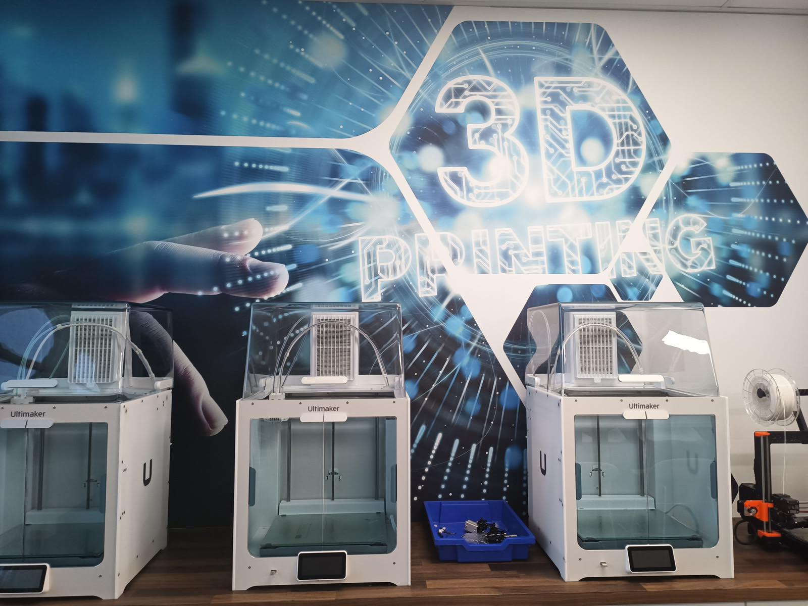

Een uitgebreide [gebruikershandleiding voor de Ultimaker S3/S5 (Engels, PDF)](https://support.ultimaker.com/hc/en-us/article_attachments/360010642079/User-manual-Ultimaker-S3-S5-v2.4.pdf) bevat meer specificaties.

Met de Ultimaker S3 3D printer kun je met verschillende materialen 3D printen, zoals PLA, ABS, PVA,, PETG, nylon en hout. Wil je gewoon met PLA in één kleur printen, dan kun je ook kiezen voor de Prusa I3 printer. De Ultimaker S5 is geschikt voor dual extrusion; hij heeft dus twee printkoppen(nozzles). Dit maakt het mogelijk om met twee verschillende kleuren of twee verschillendematerialen te printen.

Het werkveld van de Ultimaker S5 is 330 x 240 x 300 mm, de nozzlediameter is standaard 0.4 mm en

de filamentdikte is 2,85 mm.

[Download de Cura-instructie voor de Ultimaker S5 (PDF)](images/Instructie_3D_printen_Cura_-_Ultimaker_S5_versie1.1.pdf)
