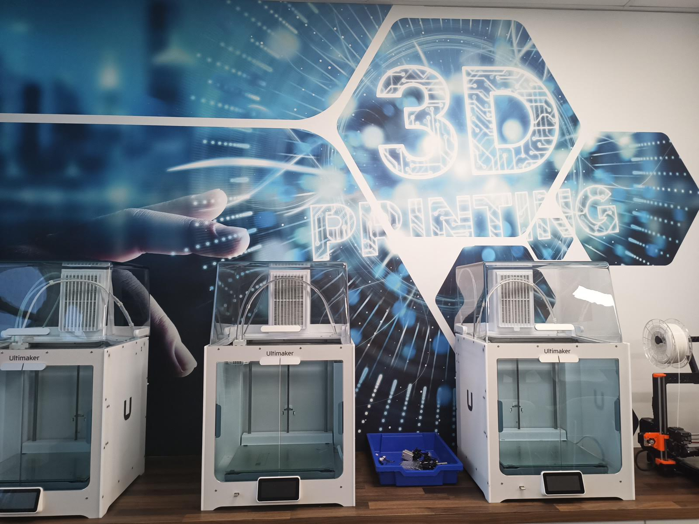

De [officiële UltiMaker S5-productpagina](https://ultimaker.com/3d-printers/s-series/ultimaker-s5/) bevat informatie over de machine.

Met de Ultimaker S5 kun je met verschillende materialen 3D-printen. Vraag een coach welke materialen en instellingen voor de printers in het FabLab zijn toegestaan. Wil je met PLA in één kleur printen, dan kun je ook kiezen voor de Prusa i3. De Ultimaker S5 is geschikt voor dual extrusion; hij heeft twee printcores. Daarmee kun je met twee verschillende kleuren of materialen printen.

Het werkveld van de Ultimaker S5 is 330 x 240 x 300 mm, de nozzlediameter is standaard 0.4 mm en

de filamentdikte is 2,85 mm.

[Download de Cura-instructie voor de Ultimaker S5 (PDF)](images/Instructie_3D_printen_Cura_-_Ultimaker_S5_versie1.1.pdf)
