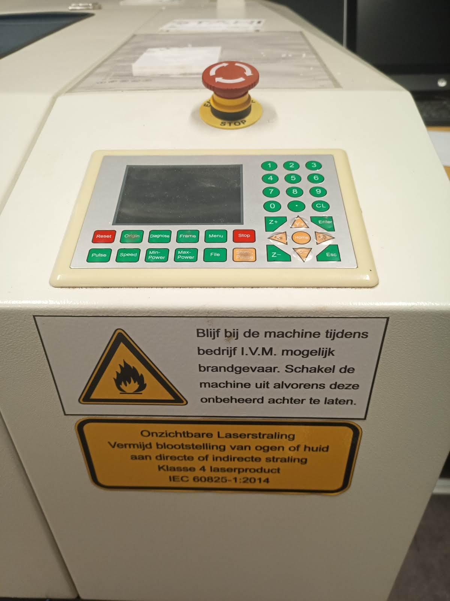
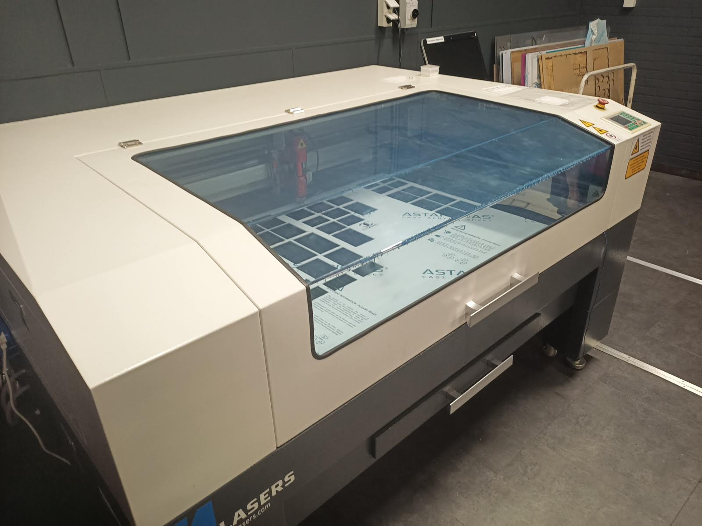
Met de BRM lasersnijder kunnen verschillende materialen gesneden en gegraveerd worden.

* Werk gebied: 90 x 130 x 23 cm. 
* Maximale afmeting materiaal: 110 x 140 cm

**LET OP! Voordat je dit apparaat zelfstandig gaat gebruiken moet je de training hebben gevolgd.**

# Materialen
De BRM lasersnijder biedt uitgebreide mogelijkheden als het gaat om lasersnijden en graveren.
Talloze materialen kunnen verwerkt worden, variërend van acryl tot hardboard en van metaal tot
textiel.

Elke soort materiaal heeft zijn eigen instellingen nodig en mogelijk ook z’n eigen lens en
doorvoernozzle. Voor metaal zijn andere lenzen en andere doorvoernozzle nodig dan voor de overige
materialen. Let hierop!

De materialen database met de richtwaarden zijn in Lightburn op de pc bij de BRM lasersnijder ingeladen. Zijn ze niet meer ingeladen dan kun je ze vinden op het bureaublad van deze pc. Ze zijn ook [hier](https://github.com/Hackerspace-drenthe/wiki-stuff/blob/main/BRM90130-x_150W.clb) te downloaden.

# Software
De laser een Ruida controller en werkt deze met Lightburn. Lightburn kun je gratis downloaden als 30 dagen uitpobeerversie. Via de hackerspace kun je 60% korting krijgen als je lightburn wilt aanschaffen. De kortingscode staat op het whiteboard.

Lightburn kan de laser en instellingen automatisch detecteren als je hem via USB aansluit.

# Checklist inschakellen BRM laser
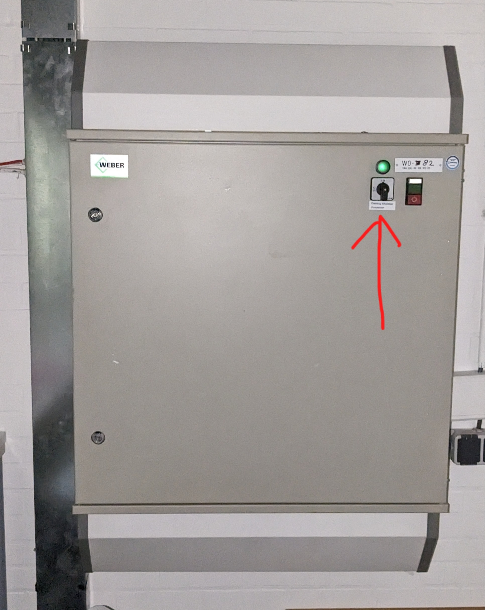Bovenstaande kast van je als je richting techlab, door de klapdeuren aan de linker muur. (ver weg!)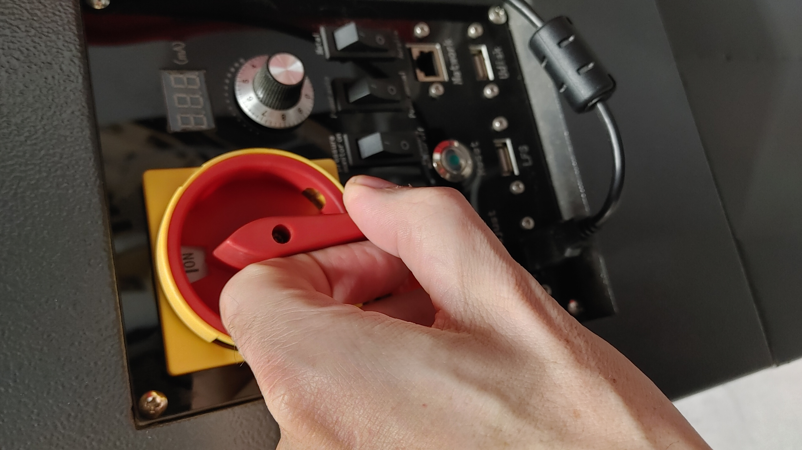
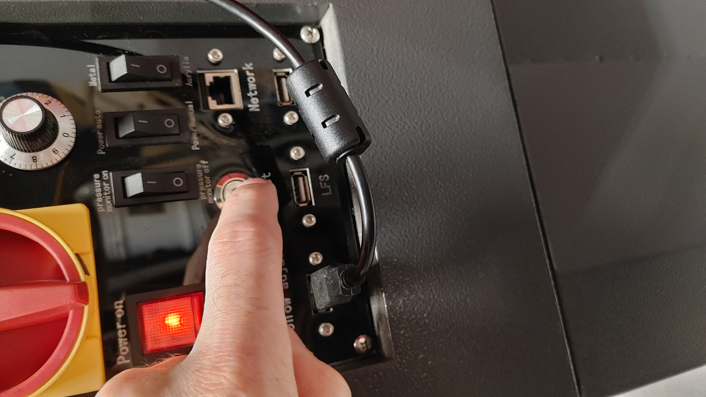
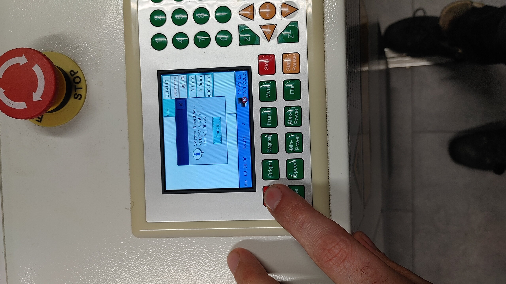

# Checklist voor kunststof/hout etc
Let op, dit is alleen voor kunstof etc. Voor metaal moet de machine omgeconfigureerd.
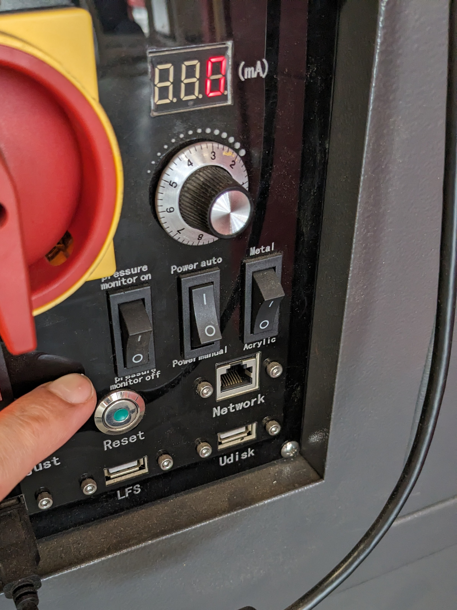

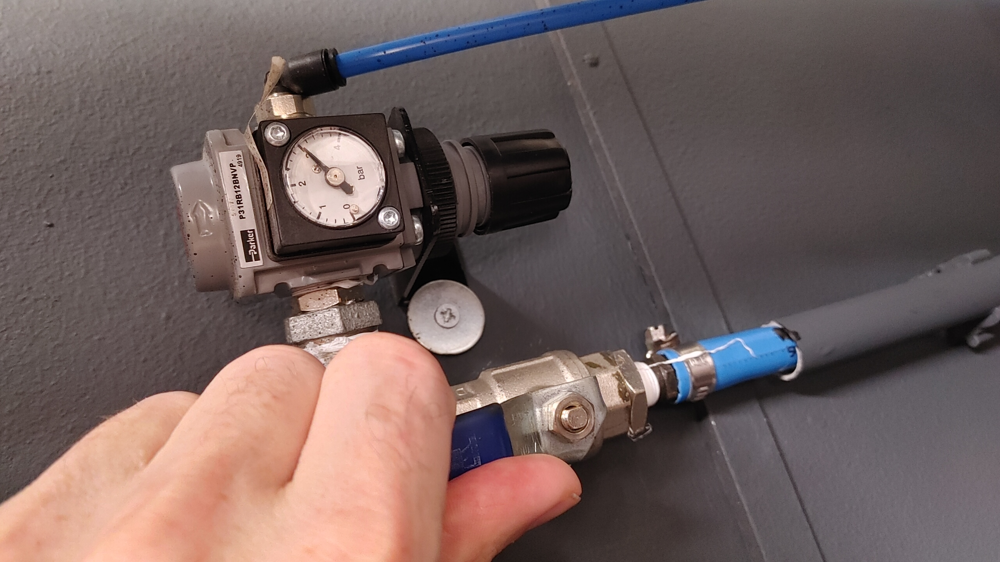
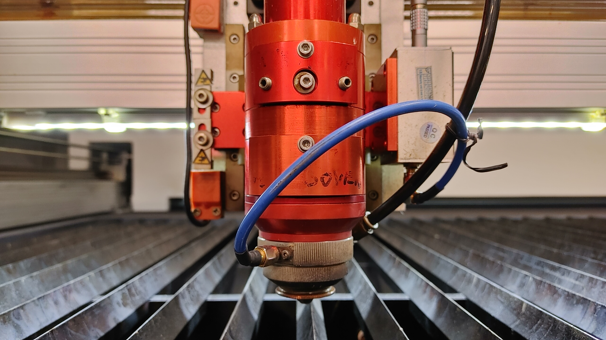
Op de lenzen staan nu labels waaraan je kan zien of de goeie geinstalleerd zijn.

# Focus instellen (bij niet-metaal)
* Beweeg de laser met de pijltjes boven je werkstuk
* Gebruik de pulse knop om een puntje te branden met de laser (pulse knop mag niet gebruikt worden bij glas, spiegels en aluminium, dan gaan de spiegels kapot).
* Gebruik de Z+ en Z- knoppen om de hoogte te veranderen.
* Het gebrande puntje moet zo klein mogelijk. Herhaal het pulsen op meerdere plekken tot je de perfecte hoogte heb
* Een hoogte van Z: 3000mm is redelijk goed voor de meeste dingen.

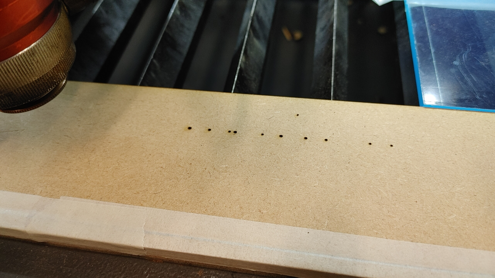

# Origin instellen
* Gebruik de pijltjes toetsen op het display om de laser in de **rechter bovenhoek** van je werkstuk te plaatsen.
* Druk op de origin knop om dit vast te leggen.

## Opdracht versturen en starten.
Dit kan vanuit lightburn en wijst zichzelf.

**Loop nooit weg tijdens het snijden, objecten kunnen in de fik vliegen bijvoorbeeld!**

# Snelheden en vermogens
### Praktische waarden, proefondervindelijk vastgesteld
Grafferen van tekst in mdf:

* Speed 50mm/s, Power 10%

### Overig
Hier een overzicht voor richtwaarden voor deze laser. Omdat het erg afhankelijk is van de staat van de laser, lenzen, spiegels en materiaal, moet je altijd wat testen en prutsen om de goede waarden te krijgen.

De onderste helft van de tabel is voor graferen.
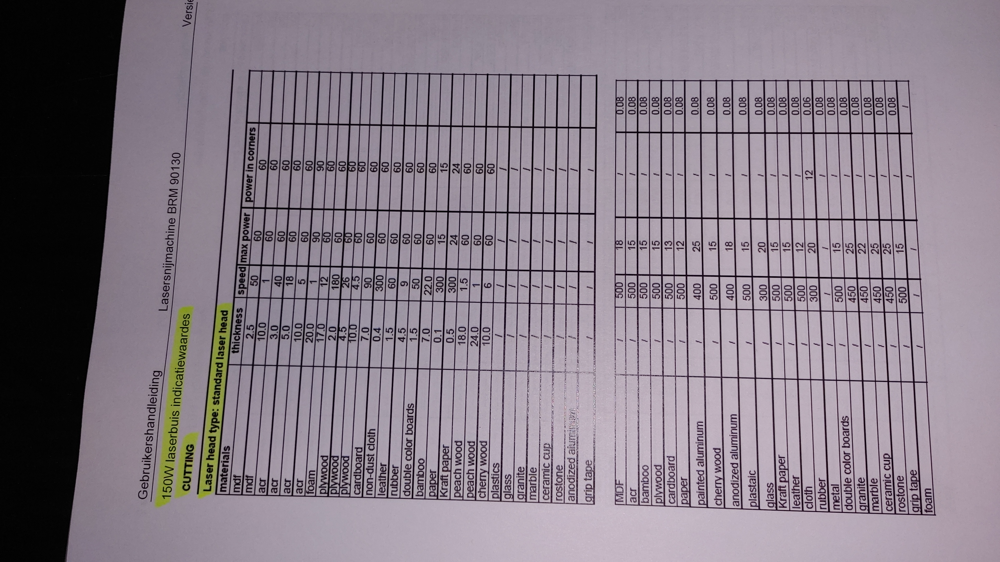Meer info
[Download de BRM-lasersnijderinstructie (PDF)](images/Instructie_BRM_lasersnijder.pdf)

[Informatie op de website van BRM](https://support.brmlasers.com/en/general/metal-laser/brm-90130-x-metal-acryl)
