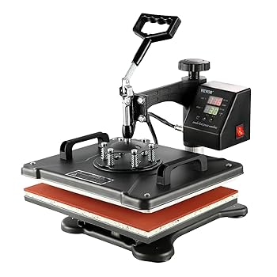
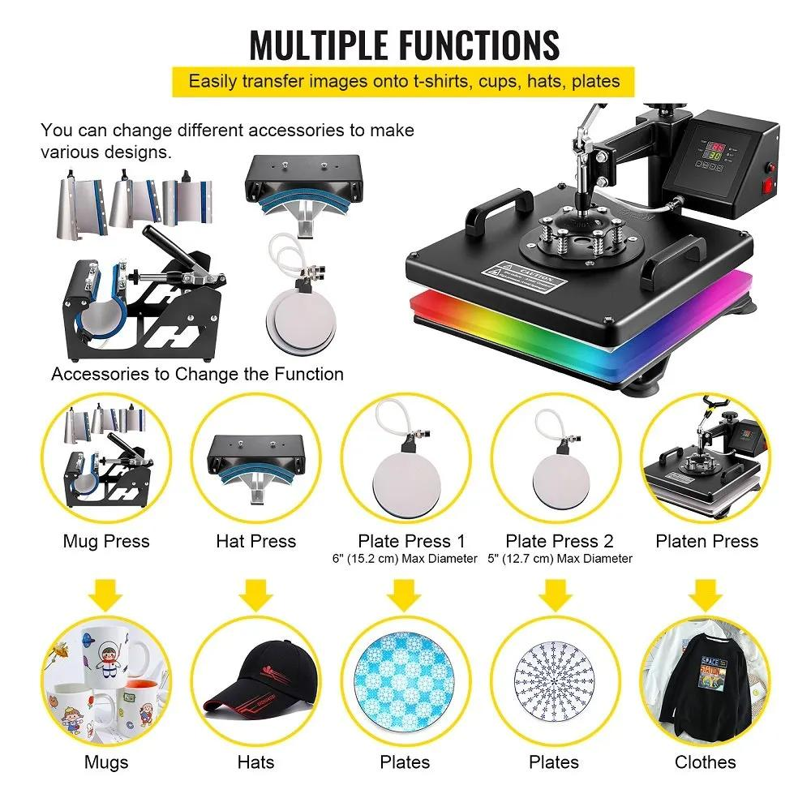
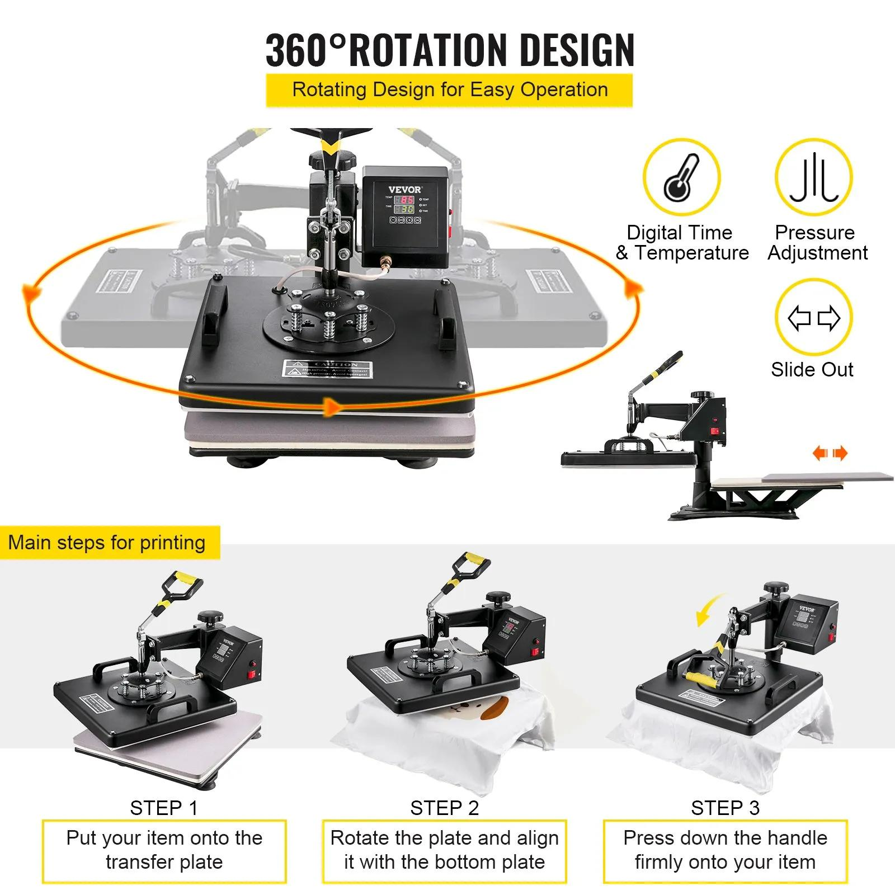

## VEVOR Warmte Persmachine

Transferpers 8 in 1 hittepers 

38 x 38 cm  

1250 w

## Hoe werkt het?
### Wat je nodig hebt voor je begint
* Een laserprinter of intkjetprinter of  dtf printer
* Speciaal papier / folie (om op te printen)
* Een ontwerp (zelf meenemen)
* Een voorwerp (Tshirt) om op te printen (zelf meenemen)
* Een warmtepers en eventueel een verloopstuk/accessoire (die hebben we)

Je hebt speciaal transfer papier nodig voor textiel of harde materialen.  Hierop print je een afbeelding met een laserprinter of een intkjet printer.  

* Laat je de pers op temperatuur komen (voorverwarmen) . Let op! HEET!!!. 
* Verwijder je de papieren laag van het printsel en legt het op het te bedrukken voorwerp in de pers. 
* Stel de pers in op de juiste temperatuur en tijd. 
* Druk de pers dicht en druk op de play knop. Nadat de tijd is verlopen klinken er piepjes en moet je de pers weer losmaken.
* Let Op!: HEET!!!
* Haal je shirt er voorzichtig uit.

### De tijd
Staat vaak gespecificieerd op de verpakking van het materiaal. 1 minuut is getest op een tshirt en werkt ok.

### De temperatuur
Staat vaak ook vermeld op de verpakking van het materiaal. 180 graden werkt wel prima tot nu toe. 

# Informatie & productdetails door leverancier
* Precieze Digitale Controle: LCD-scherm met eenvoudig te bedienen knoppen maakt het gemakkelijk om de gewenste parameters in te stellen als dat nodig is. Rust uit met het hoorbare alarm, dat de machine eraan herinnert om de verwarming te stoppen wanneer de ingestelde tijd en temperatuur zijn bereikt.
* 360 ° Wegwijze Functie: De zwenkarm is 360 graden volledig gedraaid, waardoor het verwarmingselement naar de zijkant kan bewegen, waardoor de kans op onbedoeld contact wordt verkleind. Door de druk direct en gelijkmatig naar beneden uit te oefenen, wordt de kwaliteit van de overdracht verder verbeterd.
* Verstelbare Veerplaat: Verstelbare veerplaat kan worden vervangen door verschillende accessoires, zoals mokpers, doppers, eenvoudig en eenvoudig te monteren. Het ronde ontwerp is gunstig om de druk gelijkmatig te verdelen.
* Gebruiksvriendelijke Details: De verbeterde handgrepen zijn arbeidsbesparend en stabieler. Wordt geleverd met 2 lagen thermisch isolerend katoen, een 4 mm aluminiumsilicaatpapierisolatie en een 10 mm dikke thermostabiele spons om het overdrachtseffect te verbeteren.
* 8-in-1 Veelzijdige Kit: Met een 38 x 38 cm grote warmteplaat, gebruikt de shirtpersmachine een met Teflon gecoate plaat, antiaanbaklaag en stabiel. Geschikt voor het aanbrengen van letters, cijfers en patronen op petten, T-shirts, kopjes, borden enz.

## Video's
* https://www.youtube.com/watch?v=pcNzZyXLeEI

## Afbeeldingen

# Voorbeeld ontwerpen
We hebben chatGPT gevraagd om een paar ontwerpen te maken. 

