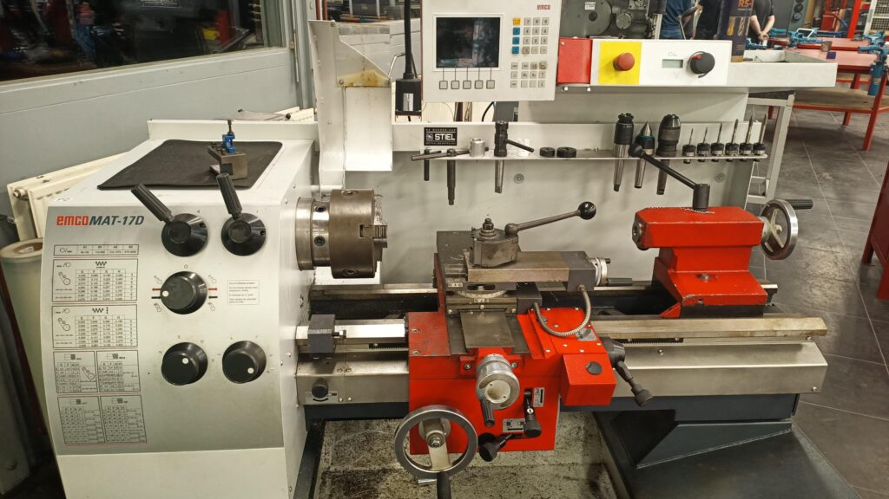

# EmcoMat-17D draaibank

Deze pagina is nog geen complete bedieningsinstructie. Gebruik de draaibank alleen
na de vereiste uitleg en volgens de handleiding voor precies dit model.

## Wat doet deze machine?

De Emcomat 17D is een draaibank. Het werkstuk draait rond en een beitel haalt
materiaal weg. Je gebruikt de machine om ronde onderdelen te maken of op maat te
draaien, zoals assen en bussen. De handleiding noemt geschikt metaal en kunststof;
controleer altijd of het materiaal bij deze machine past.

## Originele handleiding

De [EMCO Emcomat 17-handleiding](https://www.manualslib.de/manual/1161392/Emco-Emcomat-17.html)
is de originele handleiding in het Duits. De inhoud noemt ook de uitvoering EM 17D.
De kopie staat op ManualsLib; controleer het machinenummer en de uitvoering voordat
je deze handleiding gebruikt.

EMCO verwijst voor service en machine-informatie naar de
[klantenservice van EMCO](https://www.emco-world.com/en/service/customer-service.html).
Vraag daar met het model- en serienummer om een officiële PDF als je die nodig hebt.

## Nog te controleren

Laat de machinebeheerder het typeplaatje, de veiligheidsregels en de lokale werkwijze
controleren. Voeg daarna de goedgekeurde stappen voor voorbereiding, draaien, stoppen
en opruimen toe. Neem geen instellingen over van een andere draaibank.

## Kaart bij de machine

Veel machines hebben een kaart met aanwijzingen en een machinenummer. Controleer of
de kaart bij deze draaibank hoort. Vraag Bart als je twijfelt.
