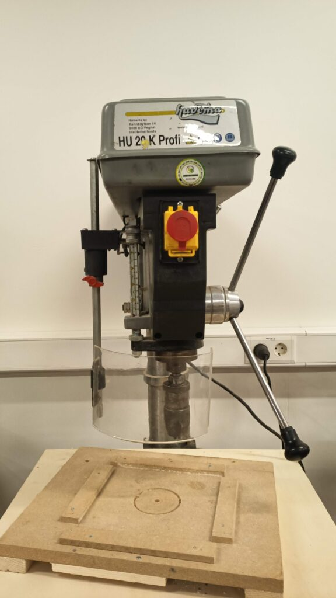

# HU20K Profi kolomboor

Deze pagina is nog geen complete bedieningsinstructie. Controleer aan de hand van
het typeplaatje of merk en model inderdaad overeenkomen met HU20K Profi.

## Wat doet deze machine?

De foto toont een kolomboor. Een kolomboor gebruikt een draaiende boor om gaten in
een werkstuk te maken. Controleer bij Bart welke materialen en boormaten bij deze
machine zijn toegestaan.

## Handleiding van de leverancier

Er staat nog geen gecontroleerde handleiding voor dit exacte model op deze site.
Laat merk, model en serienummer controleren en vraag de juiste handleiding op bij
de leverancier.

## Nog te controleren

Gebruik de machine niet zelfstandig voordat een machinebeheerder de juiste handleiding,
veiligheidsregels en werkwijze heeft bevestigd. Voeg daarna alleen gecontroleerde
stappen voor voorbereiding, gebruik en opruimen toe.

## Kaart bij de machine

Veel machines hebben een kaart met aanwijzingen en een machinenummer. Controleer of
de kaart bij deze machine hoort. Vraag Bart als je twijfelt.
