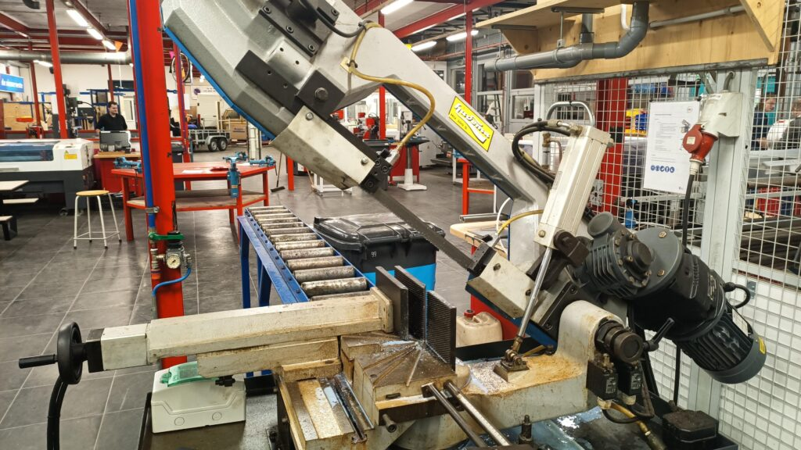
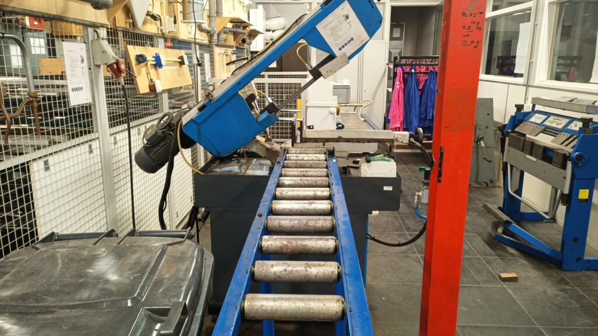

# Hudema metaalzaag voor staf en buizen

Deze pagina is nog geen complete bedieningsinstructie. Merk en model van de zaag zijn
niet bevestigd.

## Wat doet deze machine?

Een metaalzaag zaagt stafmateriaal en buizen op de gewenste lengte. Dat is handig om
materiaal voor een volgend project voor te bereiden. Dit is een andere machine dan
de [kolomboor op de HU20K Profi-pagina](/werkplaats/handleidingen/hudema-hu20k-profi).

## Handleiding van de leverancier

Er staat nog geen gecontroleerde handleiding voor deze zaag op deze site. Controleer
het typeplaatje en vraag de handleiding voor precies dit model op bij de leverancier.

## Nog te controleren

Laat een machinebeheerder de toegestane materialen, zaagbladen, beveiligingen en
werkwijze controleren. Gebruik de zaag niet zelfstandig voordat je uitleg hebt gehad.

## Kaart bij de machine

Veel machines hebben een kaart met aanwijzingen en een machinenummer. Controleer of
de kaart bij deze zaag hoort. Vraag Bart als je twijfelt.
