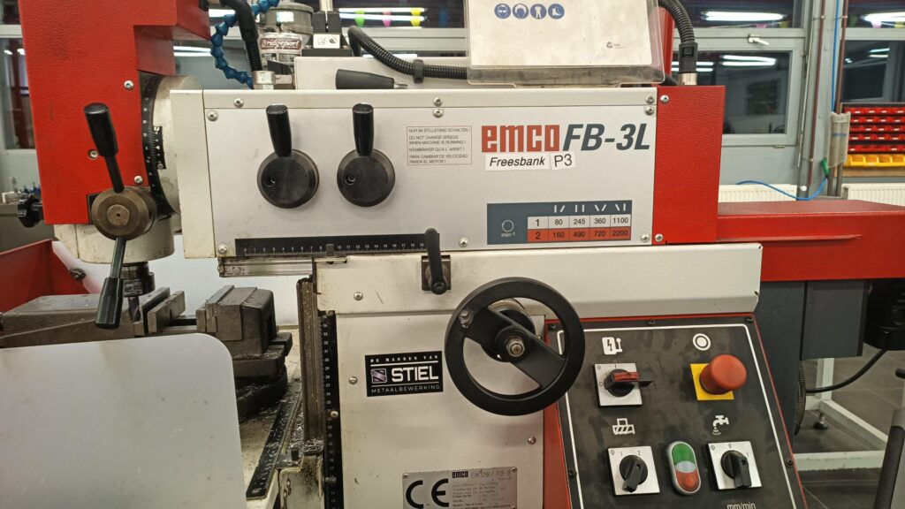

# Emco FB-3L freesbank

Deze pagina is nog geen complete bedieningsinstructie. Controleer bij de machine of
het opgegeven model en de uitvoering kloppen voordat je de machine gebruikt.

## Wat doet deze machine?

Een freesbank haalt materiaal weg met een draaiende frees. Je kunt er bijvoorbeeld
vlakken, sleuven en vormen mee maken in een werkstuk. EMCO beschrijft de FB-3 als
een handbediende freesmachine; controleer of de FB-3L in de werkplaats dezelfde
uitvoering is.

## Officiële informatie

De [officiële EMCO-productpagina](https://www.emco-world.com/en/products/milling/emcomat-fb-series/emcomat-fb-3.html)
beschrijft de Emcomat FB-3. Controleer of dit dezelfde uitvoering is als de FB-3L
in de werkplaats. Deze productpagina is geen bedieningshandleiding.

Een bedieningshandleiding voor precies deze uitvoering kon ik niet vinden. Vraag die
met het model- en serienummer op bij de
[klantenservice van EMCO](https://www.emco-world.com/en/service/customer-service.html).

## Nog te controleren

Laat een machinebeheerder de gereedschappen, beveiligingen en lokale werkwijze
controleren. Gebruik de freesbank alleen na uitleg en volgens de handleiding voor
deze uitvoering.

## Kaart bij de machine

Veel machines hebben een kaart met aanwijzingen en een machinenummer. Controleer of
de kaart bij deze freesbank hoort. Vraag Bart als je twijfelt.
