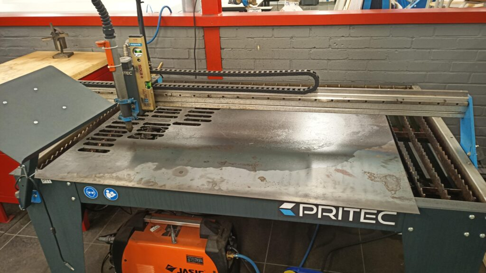

# PRITEC CNC-plasmasnijder

Deze pagina is nog geen complete bedieningsinstructie. Het exacte model en de
besturing/software zijn nog niet bevestigd.

## Wat doet deze machine?

Een plasmasnijder snijdt elektrisch geleidend metaal met een hete plasmaboog. De
CNC-besturing laat de snijkop een ingestelde vorm volgen. Zo kun je vormen en
onderdelen uit plaatmetaal snijden. Welke materialen en plaatdiktes mogen, hangt af
van de uitvoering en de instructie van de machinebeheerder.

## Originele handleidingen van Pritec

Pritec heeft een [officiële pagina met handleidingen](https://pritec-automation.com/en/pages/manuals).
Daar staan Nederlandse handleidingen voor verschillende Acros-snijtafels en Engelse
handleidingen voor Spark-plasmasnijders. Controleer het model op de machine en kies
alleen de handleiding voor die uitvoering.

Pritec heeft ook [downloads voor de besturing en software](https://pritec-automation.com/en/pages/downloads-en).
Gebruik alleen de software en instellingen die bij het machinemodel en de besturing
horen.

## Nog te controleren

Laat de machinebeheerder de vereiste training, afzuiging, beschermingsmiddelen,
materialen en noodstopprocedure controleren. Gebruik de plasmasnijder niet zonder
deze uitleg.

## Kaart bij de machine

Veel machines hebben een kaart met aanwijzingen en een machinenummer. Controleer of
de kaart bij deze plasmasnijder hoort. Vraag Bart als je twijfelt.
