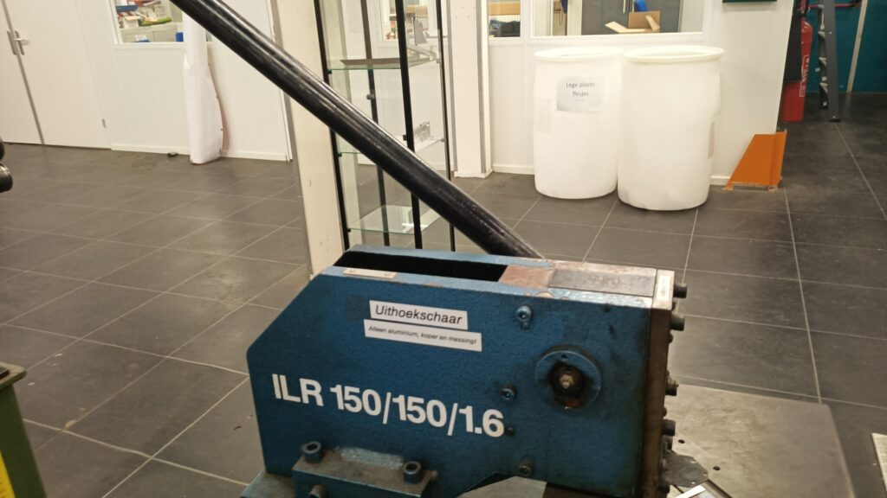
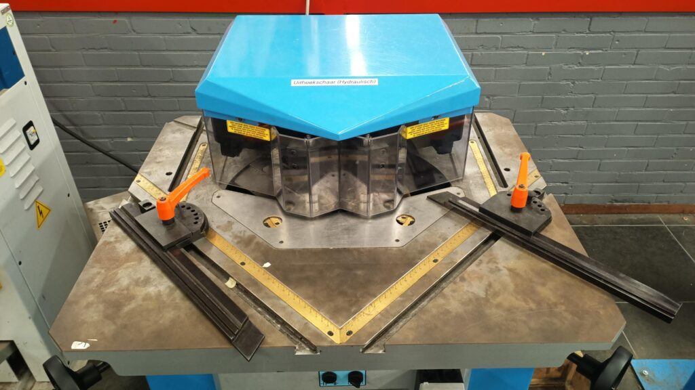

# IRL 150/150/1.6 uithoekschaar

Deze pagina is nog geen complete bedieningsinstructie. De naam van de fabrikant en
het model moeten aan de hand van het typeplaatje worden bevestigd.

## Wat doet deze machine?

Een uithoekschaar knipt een hoek of uitsparing uit plaatmetaal. Dat kan handig zijn
om plaatdelen passend te maken of voor te bereiden om te vouwen. De toegestane
plaatdikte en de precieze mogelijkheden moeten bij deze machine worden gecontroleerd.

## Handleiding van de leverancier

Er staat nog geen gecontroleerde handleiding voor dit exacte model op deze site.
Vraag de machinebeheerder om de juiste handleiding van de leverancier.

## Nog te controleren

Laat de machinebeheerder de toegestane plaatdiktes, afstelling, beveiligingen en
veilige werkhouding controleren. Gebruik de schaar niet zelfstandig voordat je uitleg
hebt gehad.

## Kaart bij de machine

Veel machines hebben een kaart met aanwijzingen en een machinenummer. Controleer of
de kaart bij deze schaar hoort. Vraag Bart als je twijfelt.
