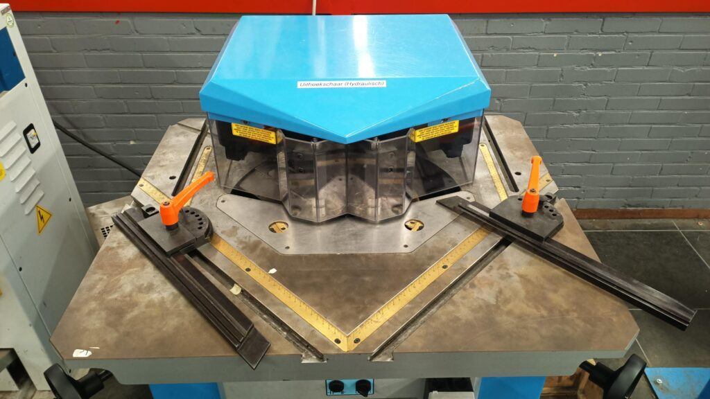

# Lifthoekschaar

Deze pagina is nog geen complete bedieningsinstructie. Merk en model van de schaar
zijn nog niet bekend.

## Wat doet deze machine?

Op de pagina over Coevorden staat een hydraulische uithoekschaar. Een uithoekschaar
knipt een hoek of uitsparing uit plaatmetaal. Controleer bij Bart of dit dezelfde
machine is als de lifthoekschaar voordat je deze beschrijving als definitief gebruikt.

## Handleiding van de leverancier

Er staat nog geen gecontroleerde handleiding voor deze machine op deze site. Controleer
het typeplaatje en vraag de juiste handleiding op bij de leverancier.

## Nog te controleren

Laat een machinebeheerder de toegestane materialen en diktes, beveiligingen en
bedieningswijze controleren. Gebruik de schaar niet zelfstandig voordat je uitleg
hebt gehad.

## Kaart bij de machine

Veel machines hebben een kaart met aanwijzingen en een machinenummer. Controleer of
de kaart bij deze schaar hoort. Vraag Bart als je twijfelt.
