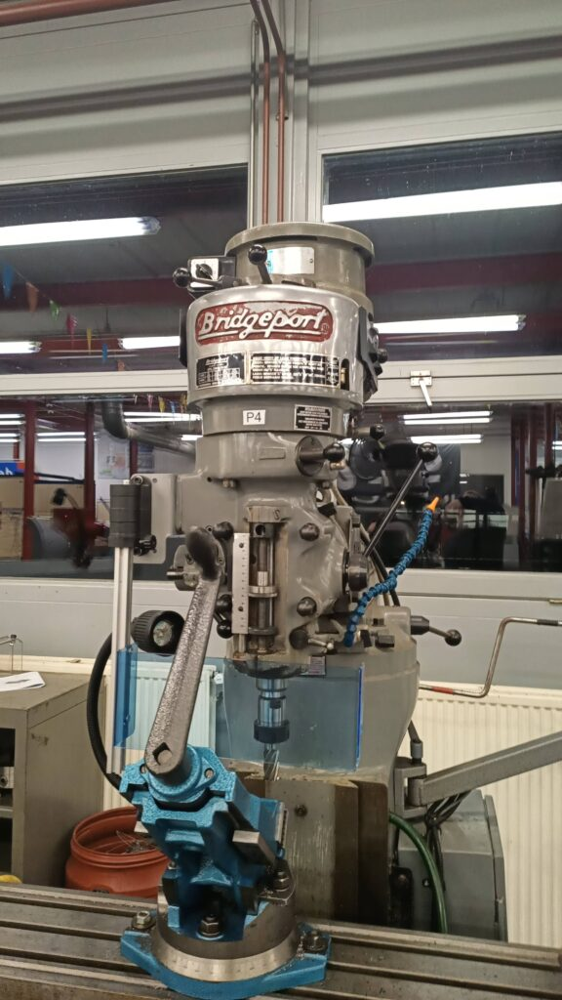

# Bridgeport handfreesmachine

Deze pagina is nog geen complete bedieningsinstructie. Bridgeport staat op het
typeplaatje, maar het exacte model is nog niet bekend.

## Wat doet deze machine?

Dit is een handbediende freesmachine. Een draaiende frees haalt materiaal van het
werkstuk weg. De tafel kan met de hand in de X- en Y-richting worden verplaatst om
het werkstuk onder de frees te zetten. Je kunt er bijvoorbeeld vlakken en sleuven
mee maken. De juiste materialen, gereedschappen en werkwijze hangen af van het
exacte model.

## Handleiding van de leverancier

Ik kon online geen handleiding vinden die aantoonbaar bij dit Bridgeport-model hoort.
De [Bridgeport-productinformatie die ik vond](https://bridgeportmachinetools.com/product/milling/)
gaat over freesmachines, maar is geen handleiding voor deze machine. Vraag met het
volledige modelnummer aan de machinebeheerder of leverancier om de juiste handleiding.

## Nog te controleren

Laat een machinebeheerder de tafelverplaatsing, beveiligingen, opspanning en veilige
werkwijze uitleggen. Gebruik de machine niet zelfstandig voordat model en instructies
duidelijk zijn.

## Kaart bij de machine

Veel machines hebben een kaart met aanwijzingen en een machinenummer. Controleer of
de kaart bij deze freesmachine hoort. Vraag Bart als je twijfelt.
