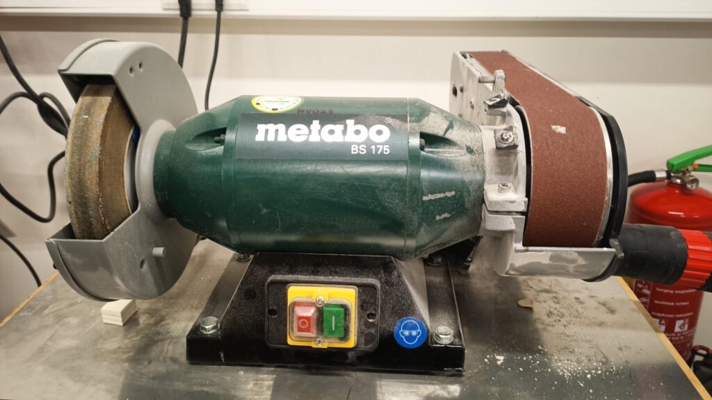

# Metabo BS-175

Deze pagina is nog geen complete bedieningsinstructie. Controleer het volledige
typenummer op het typeplaatje; alleen "BS-175" is niet genoeg om de juiste uitvoering
en handleiding vast te stellen.

## Wat doet deze machine?

Als dit de Metabo BS 175 bankslijper is, kun je die gebruiken om metaal te slijpen,
bramen weg te halen of geschikt gereedschap bij te werken. Controleer eerst of de
machine inderdaad een bankslijper is en welke slijpschijf erop zit. Vraag Bart bij
twijfel.

## Handleiding van de leverancier

Ik kon geen handleiding voor het exacte BS-175-model bevestigen. Gebruik de
[officiële Metabo-servicepagina](https://www.metabo.com/nl/nl/producten/service)
om de juiste documentatie of hulp te vinden. Geef daarbij het volledige typenummer
van het typeplaatje door.

## Nog te controleren

Laat een machinebeheerder uitleg geven over de juiste accessoires, beschermkappen,
beschermingsmiddelen en veilige werkwijze. Gebruik de machine niet zelfstandig voordat
je instructie hebt gehad.

## Kaart bij de machine

Veel machines hebben een kaart met aanwijzingen en een machinenummer. Controleer of
de kaart bij deze machine hoort. Vraag Bart als je twijfelt.
