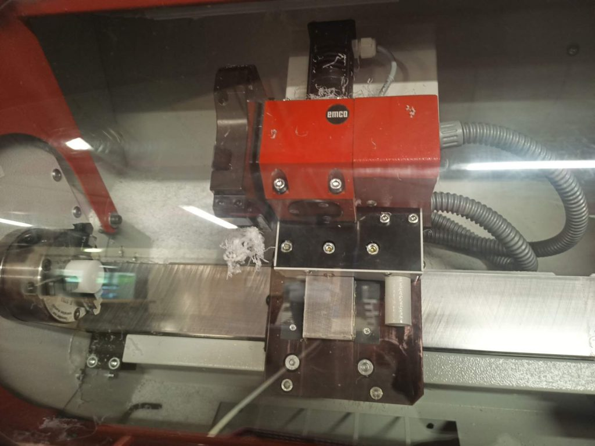
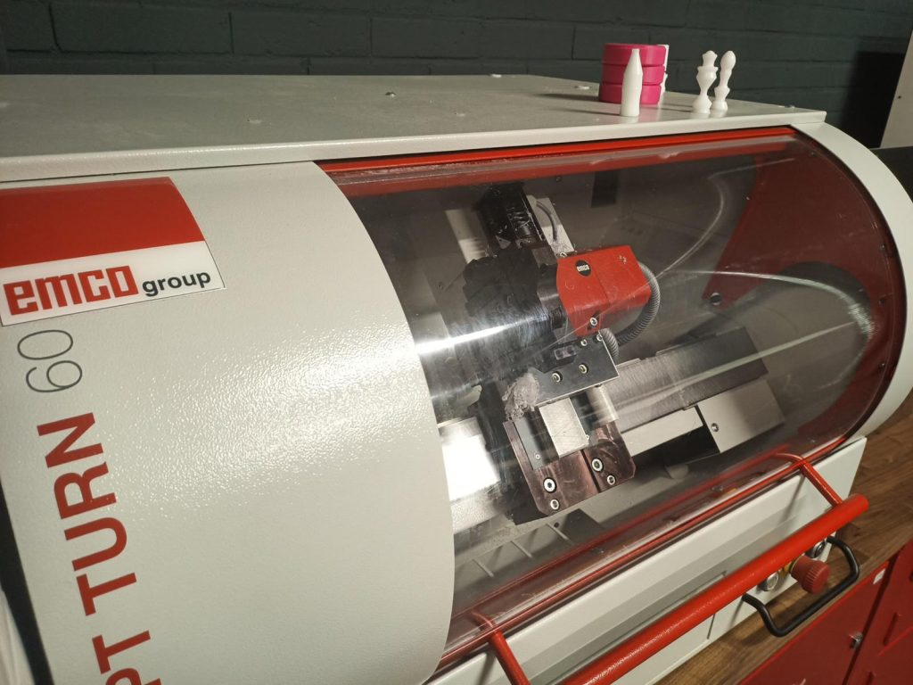
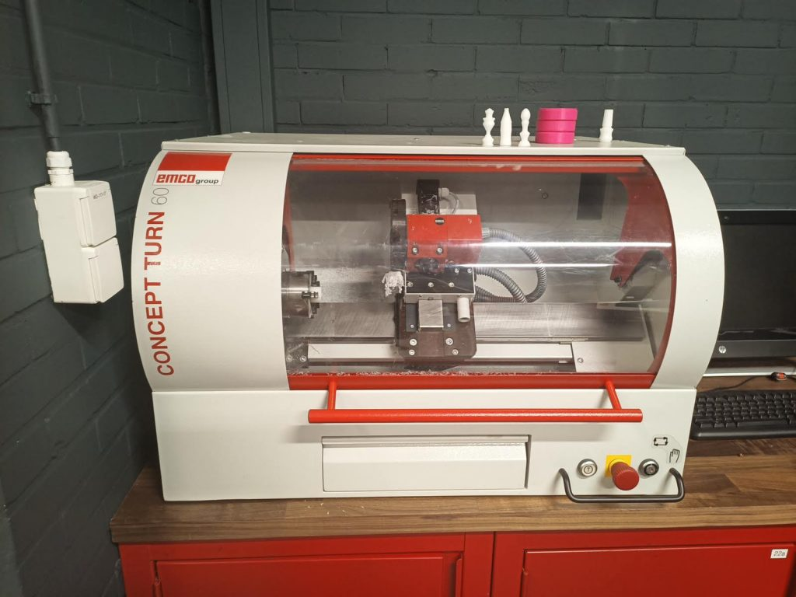

# Emco Concept Turn 60 draaibank

Deze pagina is nog geen complete bedieningsinstructie. De juiste besturing en
uitvoering moeten bij de machine worden gecontroleerd.

## Wat doet deze machine?

De Concept Turn 60 is volgens EMCO een CNC-draaibank. De computerbesturing beweegt
het snijgereedschap om een draaiend werkstuk te vormen. De machine is bedoeld voor
klein draaiwerk, zoals ronde vormen, contouren, schroefdraad en gaten. De exacte
mogelijkheden hangen af van de besturing en de afspraken in de werkplaats.

## Officiële informatie

De [officiële EMCO-productpagina voor de Concept Turn 60](https://www.emco-world.com/en/products/industrial-training/machines/turning/concept-turn/concept-turn-60.html)
bevat productinformatie, maar is geen bedieningshandleiding.

Een bedieningshandleiding voor precies deze machine en besturing kon ik niet vinden.
Vraag die met het model- en serienummer op bij de
[klantenservice van EMCO](https://www.emco-world.com/en/service/customer-service.html).

## Nog te controleren

Laat een machinebeheerder de vereiste training en lokale werkwijze controleren.
Gebruik de draaibank niet zelfstandig voordat je uitleg hebt gehad.

## Kaart bij de machine

Veel machines hebben een kaart met aanwijzingen en een machinenummer. Controleer of
de kaart bij deze draaibank hoort. Vraag Bart als je twijfelt.
