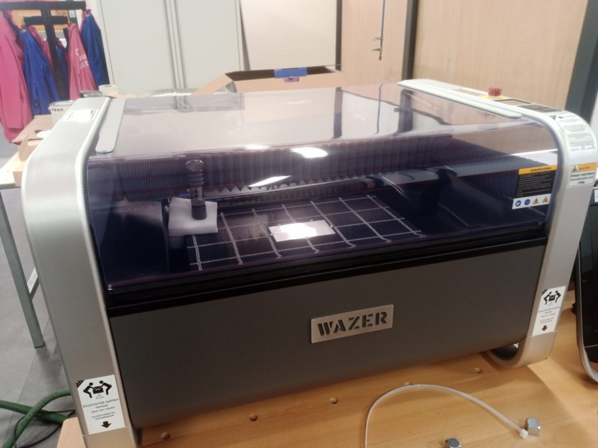
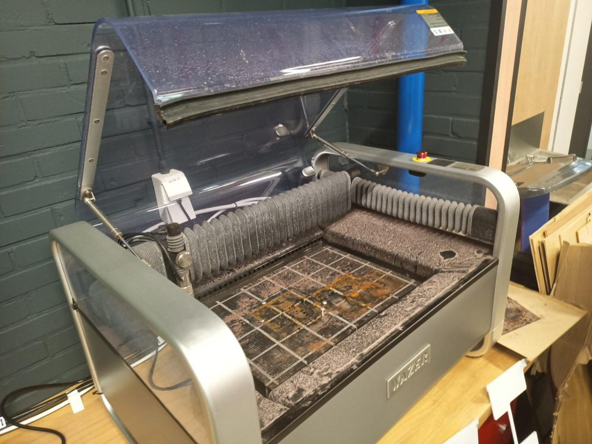

# WAZER waterstraalsnijder

Gebruik de handleiding die past bij de machine in de werkplaats. WAZER heeft aparte
handleidingen voor Desktop en Pro; er zijn ook verschillende uitvoeringen van de
Desktop. Controleer het typeplaatje en de uitvoering voordat je een handleiding volgt.

## Wat doet deze machine?

De WAZER snijdt vormen uit plaatmateriaal met een krachtige waterstraal en
snijmiddel. Dat is geschikt voor nauwkeurige vlakke onderdelen. Gebruik alleen
materialen en diktes die in de handleiding voor het aanwezige WAZER-model staan.

## Officiële handleidingen

- [WAZER Desktop: handleidingen van de leverancier](https://support.wazer.com/user-manual-downloads)
- [WAZER Desktop: Nederlandse gebruikershandleiding (PDF)](https://support.wazer.com/s/Base-WAZER-User-Manual_NL_Rev-B_online_long.pdf)
- [WAZER Pro: handleidingen van de leverancier](https://support.wazer.com/wazer-pro-user-manual-downloads)
- [WAZER Pro: Nederlandse quick-start (PDF)](https://support.wazer.com/s/WIP_WAZER-User-Manual_REV-D_NL_download.pdf)

## Voor je begint

De handleiding van de leverancier is geen vervanging voor uitleg over de machine en
de afspraken in de werkplaats. Laat een machinebeheerder bevestigen welk WAZER-model
er staat en welke handleiding erbij hoort. Gebruik de machine niet zelfstandig voordat
je de vereiste instructie hebt gehad.

## Kaart bij de machine

Veel machines hebben een kaart met aanwijzingen en een machinenummer. Controleer of
de kaart bij deze WAZER hoort. Vraag Bart als je twijfelt.
