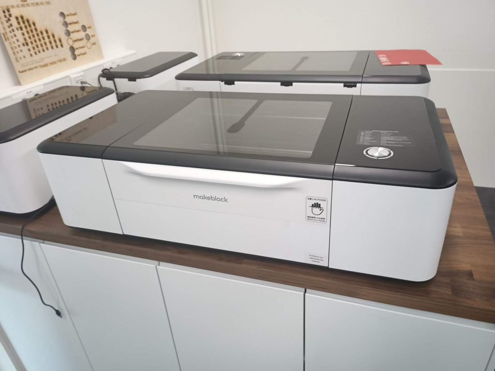

# Makeblock-laser

Deze pagina is nog geen complete bedieningsinstructie. Het exacte Makeblock-model en
de bijbehorende software zijn nog niet bekend.

## Wat doet deze machine?

Op de pagina over Coevorden staat een Makeblock Laserbox-desktoplasersnijder. Een
lasersnijder kan ontwerpen snijden of graveren in vlak materiaal dat voor de machine
geschikt is. Controleer het model, de toegestane materialen en de software voordat
je de machine gebruikt.

_Makeblock Laserbox in het FabLab._

## Handleiding van de leverancier

Er staat nog geen gecontroleerde handleiding voor dit exacte model op deze site.
Controleer het typeplaatje en vraag de leverancier om de juiste handleiding.

## Nog te controleren

Laat een machinebeheerder de juiste software, toegestane materialen, afzuiging,
beveiligingen en veilige werkwijze bevestigen. Gebruik de laser niet zelfstandig
voordat je instructie hebt gehad.

## Kaart bij de machine

Veel machines hebben een kaart met aanwijzingen en een machinenummer. Controleer of
de kaart bij deze laser hoort. Vraag Bart als je twijfelt.
