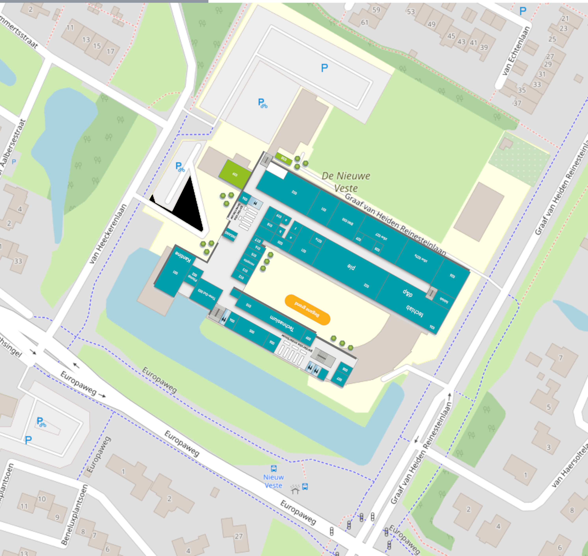

[Open de gecombineerde plattegrond met iconen (SVG)](/user/pages/05.werkplaats/plattegrond-werkplaats.svg).

  <a href="/werkplaats/ruimtes" style="display:block;padding:1rem;border:1px solid #d8dde6;border-radius:10px;background:#ffffff;text-decoration:none;color:inherit;">
    <h3 style="margin:0 0 .4rem 0;">Ruimtes</h3>
    
Overzicht van alle werkgebieden: van FabLab en VR tot hout, metaal en opslag.

  </a>
  <a href="/werkplaats/apparatuur" style="display:block;padding:1rem;border:1px solid #d8dde6;border-radius:10px;background:#ffffff;text-decoration:none;color:inherit;">
    <h3 style="margin:0 0 .4rem 0;">Apparatuur</h3>
    
Machines, devices en tools per type, inclusief directe links naar detailpagina's.

  </a>
  <a href="/werkplaats/handleidingen" style="display:block;padding:1rem;border:1px solid #d8dde6;border-radius:10px;background:#ffffff;text-decoration:none;color:inherit;">
    <h3 style="margin:0 0 .4rem 0;">Handleidingen</h3>
    
Instructies, manuals en docs om veilig en effectief met de apparatuur te werken.

  </a>

## Snelle toegang

- [Ruimtes](/werkplaats/ruimtes)
- [Apparatuur](/werkplaats/apparatuur)
- [Handleidingen](/werkplaats/handleidingen)

## Wat vind je waar?

- **Ruimtes**: waar je werkt (FabLab, VR, houtbewerking, grote werkplaats, opslag).
- **Apparatuur**: wat je gebruikt (printers, lasers, CNC, robotica, pers).
- **Handleidingen**: hoe je het veilig en juist gebruikt (instructies en documentatie).
